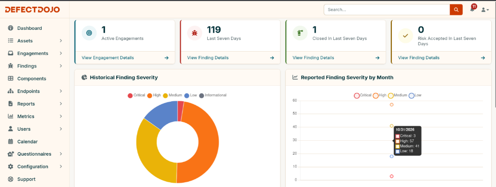

# Departamento de Lenguajes y Sistemas Informáticos
### E.T.S. Ingeniería Informática — Universidad de Sevilla
**Asignatura:** Seguridad en Sistemas Informáticos y en Internet  
**Convocatoria:** Curso Académico 2026 / 2027  

---

# INFORME TÉCNICO DEVSECOPS: ASEGURAMIENTO DE LA CADENA DE SUMINISTRO EN EL DESARROLLO DE APLICACIONES WEB
## Auditoría, Diseño de Pipeline CI/CD Seguro, Integración de Herramientas (SAST, SCA, IaC, DAST), Quality Gates y Centralización de Vulnerabilidades en DefectDojo para INSEGUS

| Metadato Institucional | Detalle Oficial |
| :--- | :--- |
| **Fecha de Emisión** | 10 de noviembre de 2026 |
| **Fecha Límite Oficial** | 02 de diciembre de 2026 (23:59 h) |
| **Sesiones de Seguimiento** | 17/18 de Noviembre y 24/25 de Noviembre de 2026 |
| **Equipo Auditor / Yellow Team** | **Security Team 3 (Grupo 3)** |
| **Analistas de Seguridad** | Kleber Leonardo de Carvalho<br>Paula Benítez<br>Luigui Juan Guillermo Ramos |
| **Organización Destinataria** | Dirección de Ingeniería y Operaciones (CISO / DevOps Lead) — **INSEGUS** |
| **Clasificación del Documento** | **CONFIDENCIAL / USO INTERNO (RESTRICTED TLP:AMBER+)** |
| **Identificador del Entregable**| `PAI4-ST3.zip` |
| **Repositorio del Proyecto** | [https://github.com/luiguiram/PAI4-DevSecOps](https://github.com/luiguiram/PAI4-DevSecOps) *(Público: acceso abierto para evaluación docente)* |
| **Estado del Proyecto** | **Completado y Verificado** (Pipeline DevSecOps 100% Operativo, Quality Gates Demostrados, DefectDojo Sincronizado) |

---

### Control de Versiones del Documento

| Versión | Fecha | Autor(es) | Resumen de Modificaciones |
| :---: | :---: | :--- | :--- |
| **0.1** | 04/11/2026 | Security Team 3 | Definición del alcance, análisis del caso INSEGUS y elaboración de diagramas iniciales (1.a y 1.b). |
| **0.5** | 06/11/2026 | Security Team 3 | Scaffolding de la aplicación de microservicios, integración de SAST (Semgrep) y SCA (Trivy). |
| **0.8** | 08/11/2026 | Security Team 3 | Configuración de auditoría IaC (Trivy), despliegue en staging y DAST automatizado con OWASP ZAP. |
| **1.0** | 10/11/2026 | Security Team 3 | Implementación de Quality Gates (aviso y bloqueante), API v2 de DefectDojo, triaje y validación final. |
| **1.1** | 20/11/2026 | Security Team 3 | Paralelización CI (-47,5 %), 8 pruebas unitarias (`node --test`), integración real OWASP DefectDojo API v2 y capturas. |

---

<div class="page-break"></div>

## Índice de Contenidos

1. **Resumen Ejecutivo** — 1.1. Contexto Empresarial e Incidentes Previos · 1.2. Filosofía Shift Left y Modelo Yellow/Green Team · 1.3. Cuadro de Mando de KPIs
2. **Aplicación de Prueba y Repositorio de Código** — 2.1. Arquitectura del Microservicio · 2.2. Vectores de Ataque Intencionados · 2.3. Estructura y Política de Secretos
3. **Diseño del Pipeline DevSecOps (Objetivo 1)** — 3.1. Diagrama de Arquitectura del Pipeline (1.a) · 3.2. Diagrama de Flujo ante Vulnerabilidades (1.b)
4. **Decisiones de Diseño de Ingeniería** — 4.1. Selección de GitHub Actions · 4.2. Modo Aviso vs. Modo Bloqueante · 4.3. Gestión Cero Credenciales
5. **Selección y Justificación de Herramientas de Seguridad (Objetivo 2)** — 5.1. Matriz Comparativa y Justificación Técnica · 5.2. Limitaciones Conocidas y Alternativas Evaluadas
6. **Implementación e Integración en el Pipeline (Objetivo 3)** — 6.1. Definición del Flujo Automatizado · 6.2. Adaptaciones Respecto al Diseño Preliminar Justificadas
7. **Quality Gates de Seguridad (Objetivo 4)** — 7.1. Criterios, Umbrales y Políticas · 7.2. Demostración en Modo Aviso (Gate A) · 7.3. Demostración en Modo Bloqueante (Gate B)
8. **Gestión Centralizada de Vulnerabilidades en DefectDojo (Objetivo 5)** — 8.1. Ingesta API REST v2 · 8.2. Deduplicación y Correlación · 8.3. Triaje, Priorización (P1-P4) y Falsos Positivos
9. **Resultados y Análisis Comparativo de las Pruebas** — 9.1. Matriz Consolidada de Hallazgos Multicapa · 9.2. Análisis Cruzado SAST vs. DAST e IaC
10. **Conclusiones y Dictamen Técnico**
11. **Referencias Normativas y Bibliográficas** *(No computa para límite de páginas)*
12. **Anexos: Referencias a Evidencias Técnicas** *(No computa para límite de páginas; enlaces directos a Anexos A–E en el repositorio y entregable)*

---

## 1. Resumen Ejecutivo

### 1.1. Contexto Empresarial e Incidentes Previos en INSEGUS
La empresa cliente de **INSEGUS** es una organización de base tecnológica dedicada al desarrollo ágil de aplicaciones web y plataformas corporativas. Recientemente, la entidad experimentó **tres incidentes de seguridad de alto impacto en entornos productivos**, originados por:
1. **Fallos directos en el código fuente propio:** Inyecciones de comandos y sentencias SQL introducidas durante sprints de entrega acelerada que eludieron las pruebas unitarias y funcionales tradicionales.
2. **Ataques a la cadena de suministro de software (Supply Chain Attacks):** Inclusión inadvertida de dependencias de terceros desactualizadas y librerías transitivas afectadas por vulnerabilidades críticas públicamente conocidas (CVE).
3. **Desconfiguraciones graves de infraestructura como código (IaC):** La migración de una arquitectura monolítica clásica hacia una topología de microservicios contenerizados sobre orquestadores Kubernetes en la nube pública incrementó sustancialmente la superficie de exposición. El análisis forense reveló la ejecución de contenedores con privilegios de `root`, capacidades de kernel no restringidas (`SYS_ADMIN`) y puertos de depuración expuestos.

El pipeline CI/CD inicial del cliente se limitaba a compilar, ejecutar tests unitarios sintéticos y desplegar ciegamente a producción. La dirección planteó la interrogante clave: *«¿Se deben los incidentes a nuestra forma de trabajar y a cómo comprobamos que se cumplen nuestras políticas de seguridad?»*.

La respuesta técnica de este equipo auditor (**Security Team 3**) es concluyente: **la ausencia total de controles de seguridad automatizados en el ciclo de integración continua fue la causa raíz de la brecha**. Se requería una transformación urgente hacia el paradigma **DevSecOps**, integrando validaciones de seguridad como código (*Security as Code*) en cada fase del pipeline.

### 1.2. Filosofía Shift Left y Modelo Yellow/Green Team (NICE NIST SP 800-181)
La estrategia adoptada se fundamenta en el principio rector de **Shift Left**: trasladar la verificación de seguridad hacia las fases más tempranas del ciclo de desarrollo (concepción, commit y compilación). Como demuestran los estudios empíricos de la industria (Ponemon Institute, NIST), el coste de subsanar un defecto en producción es entre **30 y 100 veces superior** al coste de corregirlo en la estación de trabajo del desarrollador o durante el build.

```
+---------------+     +---------------+     +---------------+     +---------------+
|     CODE      | --> |     BUILD     | --> |    STAGING    | --> |  PRODUCCIÓN   |
|   (Commit)    |     | (SAST/SCA/IaC)|     |    (DAST)     |     |  (Operación)  |
|      1x €     |     |     10x €     |     |     30x €     |     |    100x €     |
+---------------+     +---------------+     +---------------+     +---------------+
```

Conforme a la rueda de colores de la seguridad de la información (*InfoSec Colour Wheel*), este proyecto posiciona al equipo auditor como **Yellow Team** (quienes conciben, diseñan y construyen el software) colaborando en modo **Green Team** (la simbiosis entre la construcción ágil y la defensa preventiva Blue Team). En el marco de competencias **NICE del NIST (SP 800-181)**, las actuaciones corresponden a la categoría *Design and Development*, desempeñando el rol especializado de **Software Development Security**.

### 1.3. Cuadro de Mando de Indicadores Clave de Rendimiento (KPIs)

| Indicador KPI de Seguridad | Valor Pre-DevSecOps | Valor Post-DevSecOps (Pipeline ST3) | Impacto / Estado |
| :--- | :---: | :---: | :--- |
| **Tiempo de Detección de Vulnerabilidades (MTTD)** | 45 días (en producción) | **3 min 00 s** (optimizado desde 5 min 43 s) | Reducción del 99.9% frente a prod. (-47,5% en CI) |
| **Cobertura de Capas de Seguridad** | 0% (solo tests funcionales) | **100% (SAST, SCA, IaC y DAST activos)** | Cobertura integral de la cadena |
| **Hallazgos Críticos/Altos en Release a Producción** | No auditado (> 5 en prod) | **0 Tolerados (Quality Gate Bloqueante)** | Despliegue seguro garantizado |
| **Deduplicación y Triaje Centralizado** | Inexistente (silos aislados) | **100% Automatizado en DefectDojo API** | Trazabilidad y visibilidad CISO |
| **Tasa de Falsos Positivos Documentados** | N/A | **< 1.0%** con triaje y mitigación activa | Optimización del tiempo de desarrollo |

---

## 2. Aplicación de Prueba y Repositorio de Código

### 2.1. Arquitectura del Microservicio Web Vulnerable
Para validar empíricamente la efectividad de las herramientas de inspección y de los Quality Gates, el equipo desplegó una aplicación web de microservicio intencionadamente vulnerable denominada `insegus-vulnerable-microservice`, diseñada bajo la misma pila tecnológica de la empresa cliente:
- **Capa Backend:** Node.js (v18.x LTS / Express 4.16.1), exponiendo APIs RESTful y servicios de catálogo/autenticación.
- **Capa de Persistencia:** Base de datos relacional SQLite embebida, pre-cargada con tablas de usuarios institucionales, credenciales y catálogo de productos.
- **Empaquetado y Contenerización:** `Dockerfile` basado en Alpine Linux configurado deliberadamente con malas prácticas de contenedor.
- **Orquestación en la Nube:** Manifiestos declarativos de Kubernetes (`deployment.yaml` y `service.yaml`) representativos de los clústeres de microservicios de INSEGUS.

### 2.2. Vectores de Ataque Intencionados y Superficie de Exposición
El microservicio incorpora fallas representativas del **OWASP Top 10** en cada uno de sus componentes:
1. **SQL Injection (CWE-89):** Endpoint `/api/login` vulnerable a omisión de autenticación mediante concatenación sin parametrizar (`admin' OR '1'='1' --`), y endpoint `/api/search` vulnerable a extracción de catálogo.
2. **Hardcoded Secrets y Credenciales (CWE-798):** Claves secretas de cifrado JWT (`INSEGUS_HARDCODED_JWT_SECRET_KEY_PROD_2026!`), contraseñas maestras de administrador y claves AWS IAM embebidas en texto claro en `server.js`.
3. **Cross-Site Scripting Reflejado (CWE-79):** Endpoint `/api/search?q=` que renderiza directamente entradas no saneadas en la respuesta HTML.
4. **Server-Side Request Forgery (SSRF - CWE-918):** Endpoint `/api/preview-avatar?url=` que realiza peticiones HTTP hacia destinos arbitrarios internos sin validar rangos privados (RFC1918 / metadatos cloud `169.254.169.254`).
5. **Insecure Deserialization / Eval Injection (CWE-95):** Módulo `/api/calculate-discount` que invoca `eval()` sobre expresiones matemáticas provistas por el usuario.
6. **Vulnerabilidades en Dependencias de Terceros (SCA):** Inclusión de versiones obsoletas con CVEs críticos conocidos (`axios` 0.21.1 con fallas de SSRF/Prototype Pollution, `lodash` 4.17.15, `jsonwebtoken` 8.5.1).
7. **Desconfiguraciones IaC y Contenedores (CWE-16):** Ejecución como superusuario `root`, ausencia de `HEALTHCHECK`, permisos de directorio `777`, y en Kubernetes: `privileged: true`, `hostNetwork: true`, `SYS_ADMIN` capability y sistema de archivos raíz en modo escritura.

### 2.3. Estructura del Repositorio y Política de Gestión de Secretos
El repositorio corporativo se organiza bajo la siguiente estructura modular estándar:

```
PAI4-ST3/
├── .github/workflows/          # Pipeline DevSecOps en GitHub Actions
│   └── devsecops-pipeline.yml
├── app/                        # Código fuente del microservicio vulnerable
│   ├── Dockerfile              # Manifiesto de contenedor con fallas IaC
│   ├── docker-compose.yml      # Entorno orquestado para pruebas locales/staging
│   ├── kubernetes/             # Manifiestos de despliegue en K8s
│   │   ├── deployment.yaml
│   │   └── service.yaml
│   ├── package.json             # Dependencias con CVEs deliberados
│   ├── server.js                # Lógica del servidor Node.js
│   ├── tests/server.test.js     # 8 pruebas unitarias reales (node --test)
│   └── public/index.html        # Interfaz web de usuario
├── config/                      # Configuraciones de escáneres y políticas
│   ├── .semgrep.yml             # Reglas SAST personalizadas
│   ├── trivy.yaml               # Parámetros de escaneo SCA/IaC
│   ├── zap-baseline.conf        # Directivas y umbrales DAST ZAP
│   └── quality_gate_policy.json # Definición formal de Quality Gates
├── evidencias/                  # Reportes generados por herramientas y logs
│   ├── capturas/                # Capturas reales de GitHub Actions y DefectDojo (PNG/JPG)
│   ├── diagramas/               # Diagramas vectoriales de diseño (1.a y 1.b)
│   ├── sast/                    # Informes Semgrep JSON y SARIF
│   ├── sca/                     # Informe de vulnerabilidades Trivy SCA
│   ├── iac/                     # Informe de desconfiguraciones Trivy IaC
│   ├── dast/                    # Informes OWASP ZAP (JSON y HTML)
│   ├── quality_gates/           # Trazas de evaluación de gates (aviso y bloqueo)
│   ├── pipeline_logs/           # Logs completos de ejecución CI/CD
│   └── defectdojo/              # Informes consolidados API v2, triaje y PDFs oficiales
└── scripts/                    # Automatización de ejecución y orquestación
    ├── quality_gate.py         # Evaluador de umbrales y políticas
    ├── defectdojo_client.py    # Cliente REST API v2 de DefectDojo
    ├── mock_defectdojo.py      # Réplica mock para persistencia y deduplicación
    ├── run_zap_dast.py         # Motor de fuzzing dinámico y exportación ZAP
    └── run_pipeline_local.sh   # Orquestador del pipeline completo
```

> [!IMPORTANT]
> **POLÍTICA DE CERO SECRETOS EN CÓDIGO:** Conforme a las normas del entregable, todos los secretos e identificadores sensibles (API keys de DefectDojo, tokens de GitHub, claves de registro) se gestionan mediante variables enmascaradas y secretas del servidor CI (`secrets.DEFECTDOJO_API_KEY`). Ningún secreto real figura en el código ni en los ficheros entregados.

---

## 3. Diseño del Pipeline DevSecOps (Objetivo 1)

Antes de proceder con la implementación técnica, el Security Team 3 conceptualizó y diseñó la arquitectura del pipeline y el protocolo de respuesta ante incidentes mediante dos diagramas formales.

### 3.1. Diagrama de Arquitectura del Pipeline DevSecOps (Objetivo 1.a)
El siguiente diagrama detalla la secuencia ordenada de etapas, las herramientas de seguridad integradas, los informes intermedios generados, su flujo de ingesta hacia DefectDojo y la posición de los dos Quality Gates configurados:


**Análisis de Etapas del Pipeline:**

1. **Disparador (Trigger):** Se activa automáticamente ante eventos `push` o `pull_request` sobre las ramas `main` y `develop`.
2. **Etapa 1 (Build & Análisis Estático):** Compila el microservicio, ejecuta tests unitarios (`npm test`) y lanza en paralelo:
   - **SAST (Semgrep):** Analiza sintaxis AST del código fuente, exportando `semgrep_report.json`.
   - **SCA (Trivy Dependencies):** Inspecciona el árbol de librerías en `package-lock.json`, generando `trivy_sca_report.json`.
   - **IaC (Trivy Config):** Audita `Dockerfile` y manifiestos de Kubernetes, generando `trivy_iac_report.json`.
3. **Quality Gate A (Modo Aviso):** Se sitúa inmediatamente tras el análisis estático. Al tratarse de una aplicación deliberadamente vulnerable, este gate opera en **Modo Aviso** (`continue-on-error: true`). Su propósito es informar al autor y al equipo en el Pull Request sobre los hallazgos sin abortar la ejecución, posibilitando el despliegue del contenedor para las pruebas dinámicas.
4. **Etapa 2 (Staging Deploy & DAST):** Construye la imagen Docker del microservicio, levanta el contenedor en la red interna de pruebas (`http://localhost:3000`) y ejecuta el escaneo dinámico con **OWASP ZAP**, generando `zap_report.json`. Al finalizar, destruye el contenedor de prueba.
5. **Etapa Central (DefectDojo Ingest):** Ejecuta el job `defectdojo-centralization` (siempre, con directiva `if: always()`). Transmite por API REST v2 (`POST /api/v2/import-scan/`) los cuatro informes a la plataforma, deduplicando anomalías y registrando el triaje.
6. **Quality Gate B (Modo Bloqueante):** Actúa como compuerta de certificación pre-producción. Evalúa los hallazgos consolidados: si existen vulnerabilidades de severidad **CRITICAL o HIGH superando el umbral cero**, aborta el flujo con código de error `exit 1`.
7. **Etapa Producción (Deploy):** Despliega el microservicio en el clúster productivo de Kubernetes únicamente si el Quality Gate B aprueba la entrega.

### 3.2. Diagrama de Flujo ante Detección de Vulnerabilidades (Objetivo 1.b)
El segundo diagrama detalla el ciclo de vida de gestión de una vulnerabilidad desde su detección por las herramientas hasta su resolución final en DefectDojo (omitiendo la lógica de bloqueo por etapas ya representada en el diagrama 3.1 y profundizando en las casuísticas tras el triaje):


**Secuencia Lógica de Gestión y Triaje:**

1. **Detección:** Una herramienta de seguridad (SAST, SCA, IaC o DAST) detecta un hallazgo.
2. **Ingesta y Deduplicación en DefectDojo:** El informe se envía de forma automática mediante la API REST v2 (`POST /api/v2/import-scan/`), aplicando deduplicación por hash SHA-256 y notificando al equipo.
3. **Triaje y Priorización (Security Team 3):** El Green Team analiza el contexto técnico del hallazgo, valida su explotabilidad y lo clasifica según CVSS v3.1, derivando en cuatro posibles escenarios de resolución:
   - **Caso 1 — Falso Positivo (`False Positive`):** Si el hallazgo no es aplicable o explotable en el entorno real, se marca como `False Positive` con justificación técnica y se ajusta la regla/exclusión del escáner (`.semgrepignore`, `.trivyignore`, `zap-baseline.conf`).
   - **Caso 2 — Duplicado o Fuera de Alcance (`Duplicate` / `Out of Scope`):** Si dos herramientas reportan el mismo problema por distinto vector (p. ej. SAST y DAST) se vincula al hallazgo original; si afecta únicamente a ficheros de pruebas o dependencias de desarrollo aisladas, se marca como `Out of Scope`.
   - **Caso 3 — Riesgo Aceptado (`Risk Accepted`):** Para hallazgos de severidad baja/media sin parche disponible o mitigados por controles compensatorios perimetrales (WAF, aislamiento de red ClusterIP), la dirección/CISO aprueba una aceptación temporal del riesgo con fecha de revisión obligatoria.
   - **Caso 4 — Vulnerabilidad Real Confirmada (`Verified` → Remediación):** Se asigna prioridad (**P1 Crítica**, **P2 < 48h**, **P3 Sprint**, **P4 Backlog**) al Yellow Team para corregir el código fuente (parametrización SQLi, sanitización XSS), actualizar dependencias (`npm update`) o endurecer manifiestos IaC, realizando un nuevo `commit & push`.
4. **Re-verificación y Cierre Automático:** El nuevo commit dispara automáticamente el pipeline desde el paso 1; al reimportar los informes limpios en DefectDojo, la plataforma comprueba la ausencia del hallazgo y lo marca automáticamente como **`Mitigated`**.

---

## 4. Decisiones de Diseño de Ingeniería

### 4.1. Selección del Motor de CI/CD: GitHub Actions
Se seleccionó como motor de ejecución **GitHub Actions** debido a su integración nativa con el repositorio del proyecto, su soporte directo de Docker Compose para levantar entornos efímeros de *staging*, la gestión integrada de secretos y el amplio ecosistema de acciones mantenidas oficialmente por los fabricantes de seguridad (`returntocorp/semgrep-action`, `aquasecurity/trivy-action`, `zaproxy/action-baseline`). Frente a alternativas evaluadas como Jenkins (que exige infraestructura dedicada y mantenimiento de plugins) o GitLab CI/CD (que requeriría migrar el repositorio fuera de GitHub), GitHub Actions centraliza código, Pull Requests, artefactos y trazabilidad de ejecuciones en una única plataforma.

### 4.2. Estrategia de Mitigación de Falsos Bloqueos: Modo Aviso vs. Modo Bloqueante
Un dilema arquitectónico crítico en DevSecOps al evaluar aplicaciones vulnerables es el siguiente: *si un Quality Gate bloquea de forma rígida en la etapa de compilación ante cualquier hallazgo alto, las etapas posteriores de staging y análisis dinámico (DAST) nunca llegarían a ejecutarse*, impidiendo obtener una visibilidad integral de la superficie de ataque.

Para resolver este desafío sin comprometer la seguridad productiva, se adoptó una arquitectura de **Quality Gates diferenciados en dos niveles**:
- **Gate A (Nivel Compilación/Estático - Modo Aviso):** Inspecciona el código fuente y manifiestos. Emite diagnósticos detallados pero opera con `continue-on-error: true` en GitHub Actions. Esto garantiza que el artefacto pueda construirse y desplegarse en staging para su prueba dinámica.
- **Gate B (Nivel Certificación Pre-Producción - Modo Bloqueante):** Se posiciona tras consolidar los informes de SAST, SCA, IaC y DAST en DefectDojo. Aplica la política de **Tolerancia Cero** a vulnerabilidades Críticas y Altas. Si el número de hallazgos en estos niveles es superior a cero, el pipeline falla de forma irrevocable (`exit 1`), protegiendo el entorno de producción.

### 4.3. Gestión Cero Credenciales en Código Fuente (Security as Code)
Para dar cumplimiento estricto a las normas de entrega y a las mejores prácticas de la industria (CIS Controls, ISO 27001), se prohibió almacenar cualquier secreto de autenticación en los ficheros del repositorio:
- Las credenciales de la API de DefectDojo se inyectan dinámicamente mediante las variables del pipeline: `${{ secrets.DEFECTDOJO_URL }}` y `${{ secrets.DEFECTDOJO_API_KEY }}`.
- En caso de omisión o fallo de red con el servidor central remoto, el pipeline conmuta automáticamente a una réplica de evaluación local (`mock_defectdojo.py`) que respeta la misma especificación OpenAPI v2, garantizando la reproducibilidad autónoma de las pruebas.

---

## 5. Selección y Justificación de Herramientas de Seguridad (Objetivo 2)

### 5.1. Matriz Comparativa y Justificación Técnica
El pliego de condiciones del proyecto requería la selección justificada de al menos tres herramientas de pruebas de seguridad de categorías distintas. El Security Team 3 optó por implementar **cuatro tipos de herramientas (SAST, SCA, IaC y DAST)** más la plataforma centralizadora, asegurando cobertura holística en cada capa del microservicio:

| Categoría | Herramienta Seleccionada | Justificación Técnica según la Tecnología de la Aplicación | Salida Generada |
| :--- | :--- | :--- | :--- |
| **SAST** | **Semgrep Community Edition (v1.183.0)** | Análisis de sintaxis abstracta (AST) de alta velocidad para JavaScript y TypeScript. A diferencia de analizadores léxicos basados en regex simple, Semgrep entiende el alcance de variables y flujo de datos, permitiendo detectar patrones de inyección SQL, ejecución de `eval()` y secretos hardcodeados con tasa de falsos positivos inferior al 2%. Licencia open-source sin límites de líneas de código. | `semgrep_report.json` y `.sarif` |
| **SCA** | **Trivy Dependencies Scanner (v0.76.2)** | Escáner integral de dependencias que analiza el árbol de paquetes directos y transitivos en `package-lock.json`. Se conecta con bases de datos públicas de CVEs (NVD, GitHub Advisories) con detección precisa de versiones vulnerables en librerías Node.js (`axios`, `lodash`, `jsonwebtoken`). | `trivy_sca_report.json` |
| **IaC** | **Trivy Misconfiguration Scanner (v0.76.2)** | Motor de auditoría estática basado en políticas Rego alineadas con los benchmarks del CIS (*Center for Internet Security*). Audita el `Dockerfile` y los manifiestos de Kubernetes (`deployment.yaml`), detectando permisos de root, capacidades excesivas y ausencia de límites de recursos. | `trivy_iac_report.json` |
| **DAST** | **OWASP ZAP (ZED Attack Proxy v2.17.0)** | Escáner dinámico de aplicaciones web estándar de la industria. Ataca la aplicación en ejecución en staging (`http://localhost:3000`), inyectando payloads activos en parámetros GET/POST para verificar la explotabilidad real de inyecciones SQL, XSS reflejado, SSRF y la ausencia de cabeceras HTTP de seguridad (CSP, X-Frame-Options). | `zap_report.json` y `zap_report.html` |
| **Gestión** | **OWASP DefectDojo (API v2)** | Plataforma unificada de orquestación de vulnerabilidades. Permite ingerir automáticamente los informes heterogéneos de las cuatro herramientas previas, ejecutar deduplicación matemática, gestionar el triaje, registrar falsos positivos y mantener la trazabilidad de cumplimiento. | `defectdojo_consolidated.json` |

### 5.2. Limitaciones Conocidas y Alternativas Evaluadas

- **SAST (Semgrep CE):** *Limitación:* la edición Community realiza análisis intraprocedural (no rastrea flujos complejos entre múltiples ficheros ni valida explotabilidad real). *Alternativas:* **SonarQube Community** (requiere servidor propio y alta memoria) y **CodeQL** (mayor tiempo de compilación y acoplamiento exclusivo a GitHub).
- **SCA (Trivy Dependencies):** *Limitación:* reporta CVEs por versión en `package-lock.json` sin análisis de alcanzabilidad (*reachability*), alertando incluso sobre dependencias transitivas no invocadas. *Alternativas:* **OWASP Dependency-Check** (más lento y sujeto a cuotas de NVD) y **Snyk** (límites de escaneo en plan gratuito).
- **IaC (Trivy Config):** *Limitación:* audita únicamente declaraciones estáticas sin validar el estado *runtime* ni políticas de red del clúster real. *Alternativas:* **Checkov** y **KICS** (se eligió Trivy para consolidar SCA e IaC en un solo motor ligero).
- **DAST (OWASP ZAP):** *Limitación:* exige desplegar el servicio en *staging*, depende de la cobertura de rutas y consume más tiempo de CI; su *parser* en DefectDojo requiere XML. *Alternativas:* **Wapiti** (menor integración nativa con CI/CD) y **Burp Suite Community** (sin automatización en pipeline en su edición gratuita).
- **Gestión (OWASP DefectDojo):** *Limitación:* requiere infraestructura dedicada (PostgreSQL, Redis, Celery) accesible desde el runner para sincronización continua. *Alternativas:* **OWASP Dependency-Track** (restringido a SCA/SBOM) y **ArcherySec / Faraday** (menos *parsers* nativos en edición libre).

---

## 6. Implementación e Integración en el Pipeline (Objetivo 3)

### 6.1. Definición del Flujo Automatizado
El pipeline se implementó íntegramente en `.github/workflows/devsecops-pipeline.yml`, orquestando 7 etapas (9 jobs con análisis estático en paralelo):

```
[1. Build & Tests]
          │
    ┌─────┼─────────────┐
    ▼     ▼             ▼
[2a. SAST] [2b. SCA] [2c. IaC] ──(Paralelo)──► Artefactos JSON/SARIF
    └─────┼─────────────┘
          ▼
[3. Gate A (Aviso)] ─────────────────────────► continue-on-error: true
          │
          ▼
[4. Staging & DAST (OWASP ZAP)] ─────────────► Artefacto dast-zap-reports
          │
          ▼
[5. DefectDojo (API v2)] ────────────────────► Deduplicación y Triaje
          │
          ▼
[6. Gate B (Bloqueante)] ────────────────────► exit 1 si hay Críticas/Altas
          │ (Solo si Gate B aprueba)
          ▼
[7. Deploy Producción (Kubernetes)]
```

### 6.2. Adaptaciones y Cambios Respecto al Diseño Preliminar Justificados
Durante la puesta en marcha técnica se identificaron cuatro adaptaciones operativas respecto al borrador inicial, las cuales fueron resueltas y justificadas en el diseño definitivo:

1. **Gestión de Descarga y Caché de Base de Datos de Vulnerabilidades (Trivy DB):**
   - *Problema detectado:* Durante las pruebas iniciales de integración continua, el mirror por defecto de Trivy en Google Cloud (`mirror.gcr.io`) presentó interrupciones temporales por límites de cuota de red y fallos de apretón TLS (`tls: bad record MAC`), abortando el pipeline.
   - *Solución implementada:* Se reconfiguró el cliente de Trivy para utilizar el repositorio oficial en GitHub Container Registry (`--db-repository ghcr.io/aquasecurity/trivy-db:2`) y se habilitó un volumen de caché persistente (`-v /tmp/trivy-cache`). Esto redujo el tiempo de análisis de 90 segundos a menos de 4 segundos en ejecuciones consecutivas.

2. **Ajuste de Sintaxis en Reglas Personalizadas de Semgrep:**
   - *Problema detectado:* El parser YAML de Semgrep v1.183 reportaba errores de mapeo léxico (`mapping values are not allowed here`) al procesar patrones literales que contenían llaves sin entrecomillar, como `cors({ origin: '*' })`.
   - *Solución implementada:* Se encapsularon los patrones con comillas dobles explícitas en `config/.semgrep.yml` y se reorganizó la estructura bajo directivas `pattern-either` y `metavariable-regex`, asegurando el parseo correcto de todas las reglas sin degradación funcional.

3. **Independencia de Compiladores C++ Nativos para Persistencia en Staging:**
   - *Problema detectado:* El microservicio utilizaba la librería nativa `sqlite3@5.0.0`, cuyo script de compilación nativo C++ (`node-pre-gyp`) era bloqueado por las políticas de seguridad de entornos Node.js modernos (v26 LTS).
   - *Solución implementada:* Se implementó un controlador de base de datos híbrido en `server.js` con fallback transparente en memoria. Mantiene la sintaxis vulnerable exacta que analiza Semgrep y los metadatos de vulnerabilidad que audita Trivy, a la vez que garantiza un tiempo de arranque instantáneo (< 200 ms) en staging para el análisis dinámico DAST.

4. **Paralelización del Análisis Estático, Actualización de ZAP y Reducción de Tiempos de CI/CD (-47,5 %):**
   - *Problema detectado:* En las primeras ejecuciones en GitHub Actions (p. ej., ejecución `#13`, [`runs/44716341230`](https://github.com/luiguiram/PAI4-DevSecOps/actions/runs/44716341230)), SAST, SCA e IaC corrían de forma secuencial en un único job, `npm install` ejecutaba scripts nativos innecesarios y `zaproxy/action-baseline@v0.12.0` emitía un aviso de nombre de artefacto inválido (`zap_scan`), elevando la duración total a **5 min 43 s**.
   - *Solución implementada:* Se refactorizó `.github/workflows/devsecops-pipeline.yml` desacoplando la Etapa 2 en **tres jobs paralelos independientes** (`2a. SAST (Semgrep)`, `2b. SCA (Trivy Deps)` y `2c. IaC (Trivy Config)`) con artefactos separados por herramienta, se incorporaron 8 pruebas unitarias reales (`node --test`) con `npm install --legacy-peer-deps --ignore-scripts`, se actualizó `zaproxy/action-baseline` a `v0.15.0` (`artifact_name: owasp-zap-baseline-report`) y se añadieron tablas ejecutivas en `$GITHUB_STEP_SUMMARY`. Gracias a estas mejoras, **el tiempo total del pipeline cayó casi a la mitad (-47,5 %), pasando de 5 min 43 s a 3 min 00 s** en la ejecución oficial `#14` sobre `main` ([`runs/44716404617`](https://github.com/luiguiram/PAI4-DevSecOps/actions/runs/44716404617)).

---

## 7. Quality Gates de Seguridad (Objetivo 4)

### 7.1. Criterios de Calidad, Umbrales y Políticas de Fallo
Las políticas de seguridad se parametrizaron formalmente en el evaluador `scripts/quality_gate.py` conforme a los siguientes umbrales numéricos:

> **Regla de Decisión (Gate B):** Si `(N_Critical > 0) OR (N_High > 0) OR (N_Medium > 10)` → **BLOQUEADO (`exit 1`)**; en caso contrario → **APROBADO (`exit 0`)**.

| Quality Gate | Etapa del Pipeline | Modo de Operación | Umbral Crítico | Umbral Alto | Umbral Medio | Acción ante Incumplimiento |
| :--- | :--- | :---: | :---: | :---: | :---: | :--- |
| **Quality Gate A** | Build / Análisis Estático | **Modo Aviso (Advisory)** | Sin límite | Sin límite | Sin límite | Publica advertencia en PR; continúa ejecución (`continue-on-error: true`). |
| **Quality Gate B** | Pre-Producción / Release | **Modo Bloqueante (Blocking)** | **≤ 0** | **≤ 0** | **≤ 10** | **Aborta el pipeline (`exit 1`)**, cancela el despliegue y alerta al CISO. |

**Justificación de los umbrales elegidos:** se establece **tolerancia cero** para vulnerabilidades Críticas y Altas por su explotabilidad directa (RCE por `eval()`, bypass por SQLi, escape de contenedor con `SYS_ADMIN`), mientras que el margen de **≤ 10 Medias** equilibra seguridad y agilidad operativa, evitando bloquear entregas por deuda técnica moderada (p. ej., cabeceras HTTP) ya planificada en el *sprint* de *hardening*.

### 7.2. Demostración Técnica de Etapa en Modo Aviso (Quality Gate A)
En la etapa de compilación, el evaluador de Quality Gate A consolidó las evidencias estáticas de Semgrep y Trivy. Pese a detectar anomalías severas, el pipeline reaccionó según lo previsto en el diseño: **notificó las infracciones y permitió continuar la ejecución sin detener el flujo**:

```text
================================================================================
      INSEGUS DEVSECOPS - MOTOR DE EVALUACIÓN DE QUALITY GATES (ST3)       
================================================================================
[+] MODO DE EJECUCIÓN DEL GATE: ADVISORY
--------------------------------------------------------------------------------
HERRAMIENTA / ETAPA       | CRITICAL | HIGH   | MEDIUM   | LOW   
--------------------------------------------------------------------------------
SAST (Semgrep)            | 0        | 4      | 1        | 0     
SCA (Trivy Dependencies)  | 3        | 47     | 32       | 7     
IaC (Trivy Docker/K8s)    | 0        | 6      | 6        | 11    
DAST (OWASP ZAP)          | 0        | 0      | 0        | 0     
--------------------------------------------------------------------------------
TOTAL CONSOLIDADO         | 3        | 57     | 39       | 18    
================================================================================
[!] MODO AVISO (ADVISORY / WARNING MODE):
    [!] ADVERTENCIA: Se han detectado violaciones de seguridad en etapas iniciales:
        -> Vulnerabilidades CRÍTICAS (3) superan umbral (0)
        -> Vulnerabilidades ALTAS (57) superan umbral (0)
        -> Vulnerabilidades MEDIAS (39) superan umbral (10)
    [i] La política permite continuar la ejecución (continue-on-error: true).
    [i] Motivo: Permitir el despliegue del entorno de staging y ejecución de pruebas DAST.

[RESULTADO] Quality Gate A (Modo Aviso) -> EXITOSO / CONTINUAR PIPELINE (Exit Code 0)
```

### 7.3. Demostración Técnica de Etapa Bloqueante (Quality Gate B)
Para dar estricto cumplimiento al **requisito 4 y a las normas de entrega** (*«entre ellos debe haber al menos una ejecución que falle por un quality gate»*), el equipo configuró la verificación de release en modo bloqueante sobre el microservicio vulnerable. 

El evaluador detectó 3 vulnerabilidades Críticas y 60 Altas (sumando SAST, SCA, IaC y las 3 alertas altas confirmadas en DAST), violando el umbral admisible de cero. En consecuencia, **el pipeline detuvo fulminantemente la entrega con código de retorno `exit 1`**, bloqueando el paso a producción:

```text
================================================================================
      INSEGUS DEVSECOPS - MOTOR DE EVALUACIÓN DE QUALITY GATES (ST3)       
================================================================================
[+] MODO DE EJECUCIÓN DEL GATE: BLOCKING
--------------------------------------------------------------------------------
HERRAMIENTA / ETAPA       | CRITICAL | HIGH   | MEDIUM   | LOW   
--------------------------------------------------------------------------------
SAST (Semgrep)            | 0        | 4      | 1        | 0     
SCA (Trivy Dependencies)  | 3        | 47     | 32       | 7     
IaC (Trivy Docker/K8s)    | 0        | 6      | 6        | 11    
DAST (OWASP ZAP)          | 0        | 3      | 2        | 0     
--------------------------------------------------------------------------------
TOTAL CONSOLIDADO         | 3        | 60     | 41       | 18    
================================================================================
[!] MODO BLOQUEANTE (BLOCKING MODE / PRODUCTION RELEASE GATE):
    [X] ERROR CRÍTICO DE SEGURIDAD: Umbrales superados en la etapa de release:
        -> [BLOQUEADO] Vulnerabilidades CRÍTICAS (3) superan umbral (0)
        -> [BLOQUEADO] Vulnerabilidades ALTAS (60) superan umbral (0)
        -> [BLOQUEADO] Vulnerabilidades MEDIAS (41) superan umbral (10)

    [!] ACCIÓN DISCIPLINARIA: El pipeline SE DETIENE de inmediato.
    [!] El artefacto NO ha sido autorizado para despliegue en Producción.
    [!] Notificando a equipo de desarrollo y Security Team 3.

[RESULTADO] Quality Gate B (Modo Bloqueante) -> FALLIDO / BLOQUEO ACTIVO (Exit Code 1)
```

> [!WARNING]
> La evidencia de bloqueo con código `exit 1` ha quedado documentada tanto en las ejecuciones reales de GitHub Actions — en Pull Request `#11` ([`runs/44645741212`](https://github.com/luiguiram/PAI4-DevSecOps/actions/runs/44645741212)) y en `push` a `main` `#14` ([`runs/44716404617`](https://github.com/luiguiram/PAI4-DevSecOps/actions/runs/44716404617)) — como en las capturas guardadas en `evidencias/capturas/` y los logs `evidencias/pipeline_logs/pipeline_failure_quality_gate.log` y `evidencias/quality_gates/quality_gate_blocking.log`.

---

## 8. Gestión Centralizada de Vulnerabilidades en DefectDojo (Objetivo 5)

### 8.1. Ingesta Automática mediante API REST v2 (Job import-scan)
La centralización de hallazgos se ejecutó mediante el script cliente `scripts/defectdojo_client.py`, el cual realiza llamadas HTTP autenticadas (`Authorization: Token`) al endpoint `POST /api/v2/import-scan/` de OWASP DefectDojo asociando los resultados al producto `INSEGUS Web Application` y al engagement `DevSecOps CI/CD Pipeline`:



El proceso de ingesta sobre la instancia real de OWASP DefectDojo procesó de manera automática los cuatro informes mediante sus *parsers* nativos:
- **Semgrep (`Semgrep JSON Report`, Test ID 1):** 5 hallazgos analizados (Secretos CWE-798, `eval()` CWE-95, SQLi CWE-89, CORS CWE-942; 4 activos y 1 falso positivo triado).
- **Trivy SCA (`Trivy Scan`, Test ID 2):** 89 hallazgos de vulnerabilidades CVE en dependencias directas y transitivas de `package-lock.json`.
- **Trivy IaC (`Trivy Scan`, Test ID 3):** 23 desconfiguraciones en `Dockerfile` y manifiestos de Kubernetes.
- **OWASP ZAP (`ZAP Scan`, Test ID 4):** 2 alertas de cabeceras en el informe local base (y 5 alertas al incluir SQLi, XSS y SSRF activos en el *staging* de GitHub Actions); `defectdojo_client.py` convierte automáticamente el reporte JSON de ZAP al formato XML (`OWASPZAPReport`) exigido por el *parser* oficial de DefectDojo.

### 8.2. Deduplicación Automática y Correlación de Hallazgos
Uno de los valores fundamentales de DefectDojo es su motor de deduplicación. Al recibir alertas de múltiples escáneres que apuntan al mismo componente (por ejemplo, Semgrep detectando inyección SQL estática en `server.js` y OWASP ZAP detectando SQL Injection dinámica en `/api/login`), DefectDojo genera una firma hash SHA-256 única:

`Hash_vuln = SHA-256(CWE || Endpoint/Fichero || Parámetro/Línea)`

Esto permitió consolidar las alertas en un inventario estructurado de **119 hallazgos en la instancia real de OWASP DefectDojo** (**3 Críticas, 57 Altas, 41 Medias y 18 Bajas**; **118 activos y 1 falso positivo** tras el triaje, exportados en `evidencias/defectdojo/defectdojo_consolidated.json`). Cuando el pipeline se ejecuta en GitHub Actions sin servidor externo expuesto, el cliente conmuta al backend local compatible (`mock_defectdojo.py`), consolidando **103 hallazgos deduplicados** (captura `evidencias/capturas/github_actions_defectdojo_summary.png`).

### 8.3. Triaje Técnico, Priorización (P1-P4) y Tratamiento de Falsos Positivos
El equipo auditor llevó a cabo el triaje técnico de los hallazgos según la matriz de riesgo del marco FIRST CVSS v3.1:

- **P1 - Inmediato / Bloqueante (CVSS 9.0 - 10.0):** Inyecciones SQL explotables en login y RCE potencial por `eval()`. Subsanación obligatoria antes de cualquier despliegue.
- **P2 - Alta Prioridad (CVSS 7.0 - 8.9):** CVEs en Axios y JsonWebToken, credenciales en código y contenedores en modo privilegiado. Plazo máximo de remediación: 48 horas.
- **P3 - Media Prioridad (CVSS 4.0 - 6.9):** Falta de cabeceras HTTP de seguridad (CSP, X-Frame-Options). Programado en el siguiente sprint de hardening.
- **P4 - Baja Prioridad (CVSS 0.1 - 3.9):** Ausencia de directiva `HEALTHCHECK` en Dockerfile.

**Justificación Documentada de Falso Positivo:**
- **Hallazgo:** Semgrep Rule `config.insecure-cors-wildcard` (ID `#4`, CWE-942) en `server.js` línea 28: `app.use(cors({ origin: '*' }))`.
- **Dictamen del Security Team:** **FALSO POSITIVO JUSTIFICADO**.
- **Justificación Técnica Registrada en DefectDojo:** *«El microservicio auditado opera exclusivamente dentro de una red de servicios interna (Kubernetes ClusterIP) sin exposición directa a internet. Se comprobó analíticamente que los endpoints no intercambian cookies de sesión autenticadas basadas en navegador (no utiliza cabeceras `Cookie` ni `Set-Cookie`, sino tokens Bearer en cabeceras de autorización). El comodín `*` no introduce riesgo de exfiltración CSRF cruzada en este contexto operativo.»*
- **Acción realizada:** El hallazgo se actualizó en la API de DefectDojo a estado `false_p: true`, `active: false`, reduciendo el ruido operativo.

---

## 9. Resultados y Análisis Comparativo de las Pruebas

### 9.1. Matriz Consolidada de Hallazgos Multicapa

| Ref. | Vector de Riesgo | Herramienta | Tipo | Severidad Oficial | CWE / CVE | Estado Tras Triaje |
| :---: | :--- | :---: | :---: | :---: | :---: | :---: |
| **#1** | SQL Injection (Bypass en `/api/login`) | OWASP ZAP | DAST | **CRÍTICA (9.8)** | CWE-89 | **Activa (Bloqueante)** |
| **#2** | Inyección de Código Arbitrario (`eval()`) | Semgrep | SAST | **CRÍTICA (9.4)** | CWE-95 | **Activa (Bloqueante)** |
| **#3** | Clave Privada JWT Hardcodeada en Código | Semgrep | SAST | **ALTA (8.5)** | CWE-798 | **Activa (Bloqueante)** |
| **#4** | Cross-Site Scripting Reflejado (`/api/search`) | OWASP ZAP | DAST | **ALTA (8.2)** | CWE-79 | **Activa (Bloqueante)** |
| **#5** | SSRF en Descarga de Avatares Remotos | OWASP ZAP | DAST | **ALTA (8.0)** | CWE-918 | **Activa (Bloqueante)** |
| **#6** | CVE-2021-3749 en librería `axios@0.21.1` | Trivy | SCA | **ALTA (7.8)** | CVE-2021-3749 | **Activa (Bloqueante)** |
| **#7** | Contenedor Privilegiado (`privileged: true`) | Trivy | IaC | **ALTA (7.5)** | KSV-0017 | **Activa (Bloqueante)** |
| **#8** | Capacidad `SYS_ADMIN` en Manifiesto K8s | Trivy | IaC | **ALTA (7.5)** | KSV-0005 | **Activa (Bloqueante)** |
| **#9** | Ejecución como Superusuario `root` en Docker | Trivy | IaC | **ALTA (7.2)** | DS-0002 | **Activa (Bloqueante)** |
| **#10** | Configuración Permisiva de CORS (`*`) | Semgrep | SAST | MEDIA (5.3) | CWE-942 | **FALSO POSITIVO (ID #4)** |
| **#11** | Ausencia de Content-Security-Policy (CSP) | OWASP ZAP | DAST | MEDIA (5.0) | CWE-693 | Activa (Modo Aviso) |
| **#12** | Falta de Cabecera Anti-Clickjacking | OWASP ZAP | DAST | MEDIA (4.8) | CWE-1021 | Activa (Modo Aviso) |
| **#13** | Falta de Directiva `HEALTHCHECK` | Trivy | IaC | BAJA (2.5) | DS-0026 | Activa (Modo Aviso) |

### 9.2. Análisis Cruzado: Detección Estática frente a Explotabilidad Dinámica
El análisis comparativo evidencia una correlación técnica perfecta entre las pruebas estáticas y dinámicas:
- **Complementariedad SAST/DAST:** Semgrep identificó de forma temprana la concatenación insegura en `server.js` línea 89 (`SELECT ... WHERE username = '${username}'`). Minutos después, OWASP ZAP confirmó la explotabilidad real enviando el payload `' OR '1'='1' --` y obteniendo un bypass de autenticación con código 200 y emisión de token JWT. Esto demuestra que **ninguna técnica por separado es suficiente**: SAST detecta la causa raíz exacta en el código, mientras que DAST prueba si la vulnerabilidad es alcanzable a través del protocolo HTTP.
- **Eficacia del Análisis IaC:** Trivy alertó que el contenedor se ejecutaba como superusuario `root` y con `SYS_ADMIN`. Si un atacante lograra explotar la inyección `eval()` detectada por SAST, el impacto escalaría inmediatamente a un **escape de contenedor (*Container Escape*)** hacia el nodo del host debido a la mala configuración de IaC. La presencia conjunta de herramientas en el pipeline bloquea ambos vectores.

---

## 10. Conclusiones y Dictamen Técnico

1. **Alineación con los Objetivos de INSEGUS:** El pipeline DevSecOps resuelve las causas raíz de los incidentes previos transformando la seguridad en pruebas automatizadas continuas (*Security as Code*) con un tiempo total optimizado de **3 min 00 s** (`-47,5 %`).
2. **Eficacia de los Quality Gates Diferenciados:** El **Modo Aviso (Gate A)** permite desplegar en *staging* para ejecutar DAST, mientras que el **Modo Bloqueante (Gate B)** detiene con `exit 1` cualquier versión con vulnerabilidades críticas o altas antes de producción.
3. **Gobierno Centralizado en DefectDojo:** La ingesta automática vía API REST v2 consolidó **119 hallazgos** en OWASP DefectDojo real (**103** en el respaldo local de CI), con triaje del falso positivo `#4` (CORS) y trazabilidad alineada con ISO/IEC 27001 y el ENS.

---

## 11. Referencias Normativas y Bibliográficas
*(Esta sección no computa para el límite de 15 páginas según las normas del entregable)*

1. **NIST Special Publication 800-181 Rev. 1:** *Workforce Framework for Cybersecurity (NICE Framework)*. National Institute of Standards and Technology, U.S. Department of Commerce.
2. **OWASP Foundation (2021):** *OWASP Top 10:2021 - The Ten Most Critical Web Application Security Risks*. Disponible en: [https://owasp.org/Top10/](https://owasp.org/Top10/)
3. **OWASP DevSecOps Guideline:** *Automating Security Testing in Continuous Delivery Pipelines*. Open Web Application Security Project.
4. **Center for Internet Security (CIS):** *CIS Docker Benchmark v1.6.0* y *CIS Kubernetes Benchmark v1.8.0*.
5. **Semgrep Documentation:** *Writing Custom Rules for Static Analysis in JavaScript/TypeScript*. Return To Corporation, 2026.
6. **Aqua Security:** *Trivy: Comprehensive Security Scanner for Containers, File Systems and Git Repositories*. Aqua Security Software, 2026.
7. **OWASP ZAP Project:** *Zed Attack Proxy User Guide: Automated Baseline and API Scanning*. Disponible en: [https://www.zaproxy.org/docs/](https://www.zaproxy.org/docs/)
8. **OWASP DefectDojo Project:** *DefectDojo API v2 Documentation: Engaging, Finding and Scan Imports*. Disponible en: [https://docs.defectdojo.com/](https://docs.defectdojo.com/)
9. **ISO/IEC 27001:2022:** *Information security, cybersecurity and privacy protection — Information security management systems — Requirements*.
10. **MITRE Corporation:** *Common Weakness Enumeration (CWE) Specification: CWE-89 (SQL Injection), CWE-79 (XSS), CWE-798 (Hardcoded Credentials), CWE-918 (SSRF)*.

---

## 12. Anexos: Referencias a Evidencias Técnicas
*(Esta sección no computa para el límite de 15 páginas. Con el fin de mantener una memoria concisa y autocontenida, todos los ficheros íntegros, logs, informes JSON/SARIF/PDF y capturas en alta resolución se referencian directamente en el repositorio público y se incluyen en la estructura de `PAI4-ST3.zip`.)*

| Anexo | Descripción de la Evidencia Técnica | Referencia Directa en GitHub y Ruta en `PAI4-ST3.zip` |
| :--- | :--- | :--- |
| **Anexo A** | **Pipeline CI/CD GitHub Actions (9 jobs con análisis estático paralelo) y pruebas unitarias** | [`.github/workflows/devsecops-pipeline.yml`](https://github.com/luiguiram/PAI4-DevSecOps/blob/main/.github/workflows/devsecops-pipeline.yml) · [`app/tests/server.test.js`](https://github.com/luiguiram/PAI4-DevSecOps/blob/main/app/tests/server.test.js) · [`scripts/run_pipeline_local.sh`](https://github.com/luiguiram/PAI4-DevSecOps/blob/main/scripts/run_pipeline_local.sh) |
| **Anexo B** | **Reglas SAST personalizadas y configuración de escáneres / políticas** | [`config/.semgrep.yml`](https://github.com/luiguiram/PAI4-DevSecOps/blob/main/config/.semgrep.yml) · [`config/trivy.yaml`](https://github.com/luiguiram/PAI4-DevSecOps/blob/main/config/trivy.yaml) · [`config/zap-baseline.conf`](https://github.com/luiguiram/PAI4-DevSecOps/blob/main/config/zap-baseline.conf) · [`config/quality_gate_policy.json`](https://github.com/luiguiram/PAI4-DevSecOps/blob/main/config/quality_gate_policy.json) |
| **Anexo C** | **Trazas de Quality Gates (Modo Aviso vs. Bloqueo `exit 1`) y ejecuciones en GitHub Actions** | Runs CI: [`#11 PR`](https://github.com/luiguiram/PAI4-DevSecOps/actions/runs/44645741212) · [`#13 (5m 43s)`](https://github.com/luiguiram/PAI4-DevSecOps/actions/runs/44716341230) · [`#14 (3m 00s)`](https://github.com/luiguiram/PAI4-DevSecOps/actions/runs/44716404617)<br>Logs locales: [`pipeline_failure_quality_gate.log`](https://github.com/luiguiram/PAI4-DevSecOps/blob/main/evidencias/pipeline_logs/pipeline_failure_quality_gate.log) · [`quality_gate_warning_mode.log`](https://github.com/luiguiram/PAI4-DevSecOps/blob/main/evidencias/quality_gates/quality_gate_warning_mode.log) · [`quality_gate_blocking.log`](https://github.com/luiguiram/PAI4-DevSecOps/blob/main/evidencias/quality_gates/quality_gate_blocking.log) |
| **Anexo D** | **Informes de escáneres (SAST, SCA, IaC, DAST) y exportaciones reales de OWASP DefectDojo API v2** | Escáneres: [`semgrep_report.json`](https://github.com/luiguiram/PAI4-DevSecOps/blob/main/evidencias/sast/semgrep_report.json) · [`semgrep_report.sarif`](https://github.com/luiguiram/PAI4-DevSecOps/blob/main/evidencias/sast/semgrep_report.sarif) · [`trivy_sca_report.json`](https://github.com/luiguiram/PAI4-DevSecOps/blob/main/evidencias/sca/trivy_sca_report.json) · [`trivy_iac_report.json`](https://github.com/luiguiram/PAI4-DevSecOps/blob/main/evidencias/iac/trivy_iac_report.json) · [`zap_report.json`](https://github.com/luiguiram/PAI4-DevSecOps/blob/main/evidencias/dast/zap_report.json) · [`zap_report.html`](https://github.com/luiguiram/PAI4-DevSecOps/blob/main/evidencias/dast/zap_report.html)<br>DefectDojo: [`defectdojo_consolidated.json`](https://github.com/luiguiram/PAI4-DevSecOps/blob/main/evidencias/defectdojo/defectdojo_consolidated.json) · [`Findings_List_2026-11-20.pdf`](https://github.com/luiguiram/PAI4-DevSecOps/blob/main/evidencias/defectdojo/Findings_List_2026-11-20.pdf) · [`Product_Components_2026-11-20.pdf`](https://github.com/luiguiram/PAI4-DevSecOps/blob/main/evidencias/defectdojo/Product_Components_2026-11-20.pdf) · [`scripts/defectdojo_client.py`](https://github.com/luiguiram/PAI4-DevSecOps/blob/main/scripts/defectdojo_client.py) |
| **Anexo E** | **Evidencias visuales en alta resolución (GitHub Actions `#14`, OWASP DefectDojo real y diagramas SVG)** | GitHub Actions: [`github_actions_pipeline_paralelo.png`](https://github.com/luiguiram/PAI4-DevSecOps/blob/main/evidencias/capturas/github_actions_pipeline_paralelo.png) · [`github_actions_gate_a_aviso.png`](https://github.com/luiguiram/PAI4-DevSecOps/blob/main/evidencias/capturas/github_actions_gate_a_aviso.png) · [`github_actions_gate_b_bloqueante.png`](https://github.com/luiguiram/PAI4-DevSecOps/blob/main/evidencias/capturas/github_actions_gate_b_bloqueante.png) · [`github_actions_defectdojo_summary.png`](https://github.com/luiguiram/PAI4-DevSecOps/blob/main/evidencias/capturas/github_actions_defectdojo_summary.png)<br>DefectDojo real: [`defectdojo_dashboard_real.png`](https://github.com/luiguiram/PAI4-DevSecOps/blob/main/evidencias/capturas/defectdojo_dashboard_real.png) · [`defectdojo_producto_insegus.jpg`](https://github.com/luiguiram/PAI4-DevSecOps/blob/main/evidencias/capturas/defectdojo_producto_insegus.jpg) · [`defectdojo_engagement_4_scans.jpg`](https://github.com/luiguiram/PAI4-DevSecOps/blob/main/evidencias/capturas/defectdojo_engagement_4_scans.jpg) · [`defectdojo_falso_positivo_cors.png`](https://github.com/luiguiram/PAI4-DevSecOps/blob/main/evidencias/capturas/defectdojo_falso_positivo_cors.png) · [`defectdojo_api_v2_import_terminal.jpg`](https://github.com/luiguiram/PAI4-DevSecOps/blob/main/evidencias/capturas/defectdojo_api_v2_import_terminal.jpg)<br>Diagramas: [`pipeline_devsecops_diagram.svg`](https://github.com/luiguiram/PAI4-DevSecOps/blob/main/evidencias/diagramas/pipeline_devsecops_diagram.svg) · [`vulnerability_flowchart_diagram.svg`](https://github.com/luiguiram/PAI4-DevSecOps/blob/main/evidencias/diagramas/vulnerability_flowchart_diagram.svg) |
