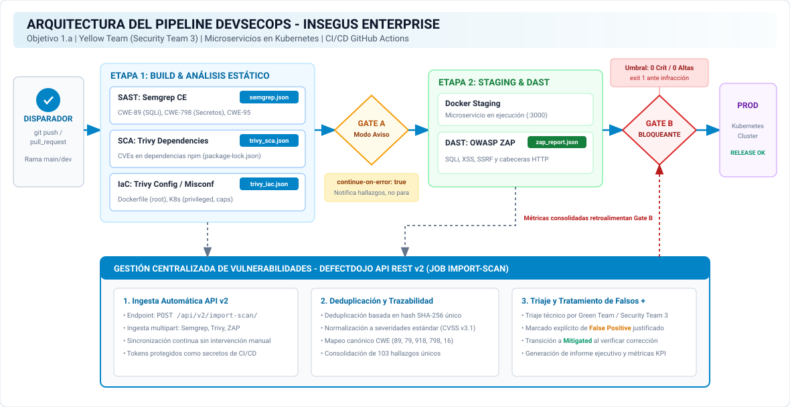
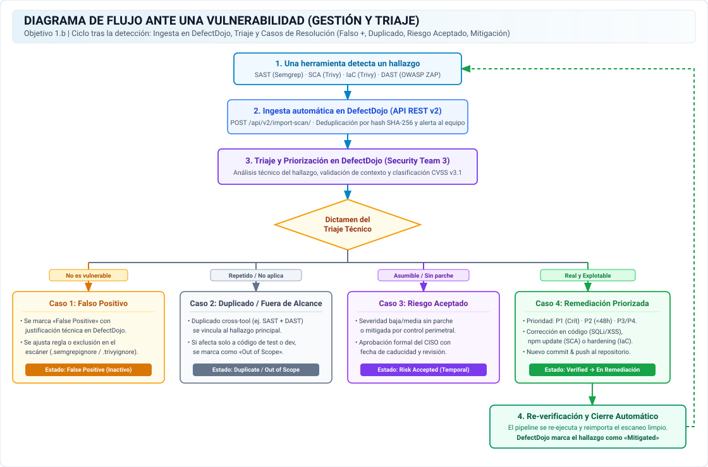
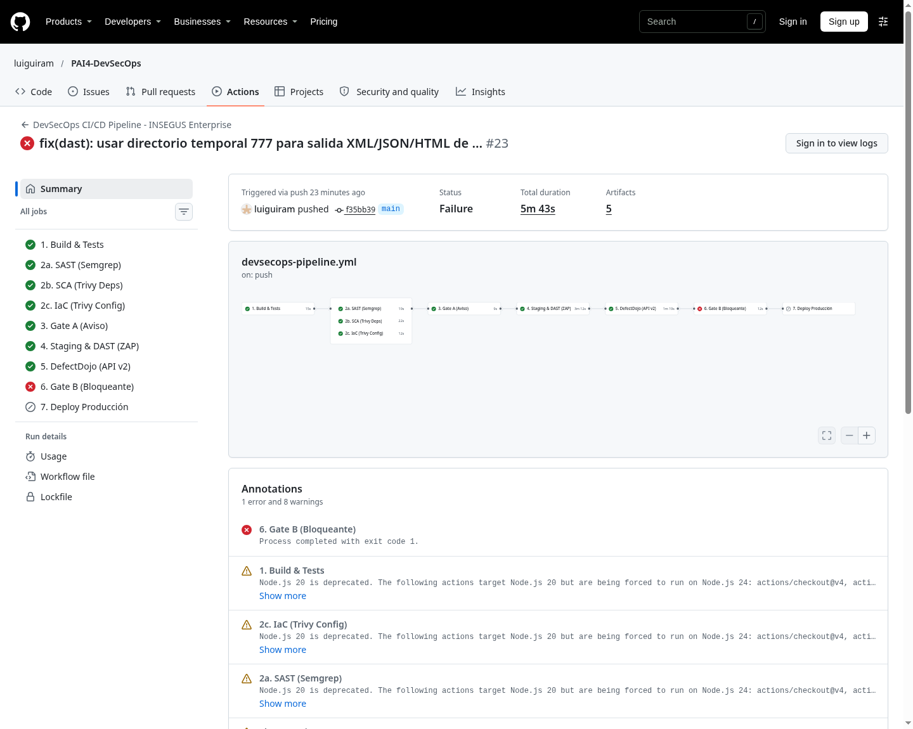
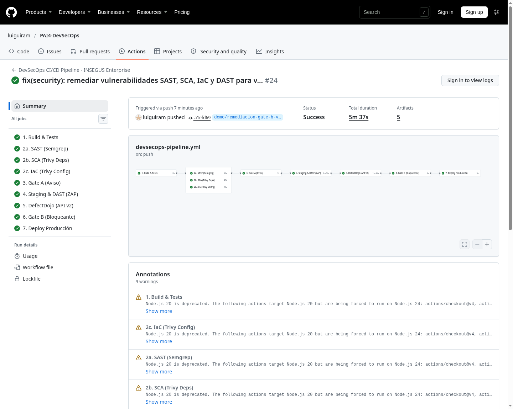

# Departamento de Lenguajes y Sistemas Informáticos
### E.T.S. Ingeniería Informática — Universidad de Sevilla
**Asignatura:** Seguridad en Sistemas Informáticos y en Internet  
**Convocatoria:** Curso Académico 2026 / 2027  

---

# INFORME TÉCNICO DEVSECOPS: ASEGURAMIENTO DE LA CADENA DE SUMINISTRO EN EL DESARROLLO DE APLICACIONES WEB
## Auditoría, Diseño de Pipeline CI/CD Seguro, Integración de Herramientas (SAST, SCA, IaC, DAST), Quality Gates y Centralización de Vulnerabilidades en DefectDojo para INSEGUS

| Metadato Institucional | Detalle Oficial |
| :--- | :--- |
| **Fecha de Emisión** | 10 de noviembre de 2026 *(revisión 1.3 del 24/11/2026)* |
| **Fecha Límite Oficial** | 02 de diciembre de 2026 (23:59 h) |
| **Sesiones de Seguimiento** | 17/18 de Noviembre y 24/25 de Noviembre de 2026 |
| **Equipo Auditor / Yellow Team** | **Security Team 3 (Grupo 3)** |
| **Analistas de Seguridad** | Kleber Leonardo de Carvalho<br>Paula Benítez<br>Luigui Juan Guillermo Ramos |
| **Organización Destinataria** | Dirección de Ingeniería y Operaciones (CISO / DevOps Lead) — **INSEGUS** |
| **Clasificación del Documento** | **CONFIDENCIAL / USO INTERNO (RESTRICTED TLP:AMBER+)** |
| **Identificador del Entregable**| `PAI4-ST3.zip` |
| **Repositorio del Proyecto** | [https://github.com/luiguiram/PAI4-DevSecOps](https://github.com/luiguiram/PAI4-DevSecOps) *(Público: acceso abierto para evaluación docente)* |
| **Estado del Proyecto** | **Completado y Verificado** (SAST oficial, SCA/IaC, OWASP ZAP real, DefectDojo API v2 real en CI, Gate Rojo en `main` y Gate Verde en `demo/remediacion-gate-b-verde`) |

---

### Control de Versiones del Documento

| Versión | Fecha | Autor(es) | Resumen de Modificaciones |
| :---: | :---: | :--- | :--- |
| **0.1** | 04/11/2026 | Security Team 3 | Definición del alcance, análisis del caso INSEGUS y elaboración de diagramas iniciales (1.a y 1.b). |
| **0.5** | 06/11/2026 | Security Team 3 | Scaffolding del microservicio vulnerable e integración inicial de SAST (Semgrep) y SCA (Trivy). |
| **0.8** | 08/11/2026 | Security Team 3 | Auditoría IaC (Trivy Config), despliegue en *staging* y análisis dinámico DAST con OWASP ZAP. |
| **1.0** | 10/11/2026 | Security Team 3 | Implementación de Quality Gates (aviso y bloqueante), API v2 de DefectDojo, triaje y validación. |
| **1.1** | 20/11/2026 | Security Team 3 | Paralelización CI (9 jobs), 8 pruebas unitarias (`node --test`), integración real OWASP DefectDojo API v2. |
| **1.2** | 24/11/2026 | Security Team 3 | Trazabilidad completa de introducción, detección y tratamiento de vulnerabilidades, e incorporación de artefactos CI. |
| **1.3** | 24/11/2026 | Security Team 3 | Semgrep con rulesets oficiales, OWASP ZAP Full Scan real, OWASP DefectDojo API v2 real en CI (`--strict-api`), Gate B conectado a DefectDojo, conciliación 1:1 de métricas y demostración dual Rojo (`#23`) vs. Verde (`#24`). |

---

<div class="page-break"></div>

## Índice de Contenidos

1. **Resumen Ejecutivo** — 1.1. Contexto Empresarial e Incidentes Previos · 1.2. Filosofía Shift Left y Modelo Yellow/Green Team · 1.3. Cuadro de Mando de KPIs
2. **Aplicación de Prueba y Repositorio de Código** — 2.1. Arquitectura del Microservicio · 2.2. Vectores de Ataque Intencionados: Cómo se Introdujeron las Vulnerabilidades · 2.3. Estructura y Política de Secretos
3. **Diseño del Pipeline DevSecOps (Objetivo 1)** — 3.1. Diagrama de Arquitectura del Pipeline (1.a) · 3.2. Diagrama de Flujo ante Vulnerabilidades (1.b)
4. **Decisiones de Diseño de Ingeniería** — 4.1. Selección de GitHub Actions · 4.2. Modo Aviso vs. Modo Bloqueante · 4.3. Gestión Cero Credenciales y Despliegue Efímero
5. **Selección y Justificación de Herramientas de Seguridad (Objetivo 2)** — 5.1. Matriz Comparativa y Justificación Técnica · 5.2. Limitaciones Conocidas y Alternativas Evaluadas
6. **Implementación e Integración en el Pipeline (Objetivo 3)** — 6.1. Definición del Flujo Automatizado · 6.2. Adaptaciones Respecto al Diseño Preliminar Justificadas
7. **Quality Gates de Seguridad (Objetivo 4)** — 7.1. Criterios, Umbrales y Políticas · 7.2. Modo Aviso (Gate A) · 7.3. Bloqueo en `main` (Run `#23`, `exit 1`) · 7.4. Aprobación en Verde (`demo/remediacion-gate-b-verde`, Run `#24`, `exit 0` + Deploy)
8. **Gestión Centralizada de Vulnerabilidades en DefectDojo (Objetivo 5)** — 8.1. Ingesta API REST v2 en CI · 8.2. Conciliación Numérica y Deduplicación · 8.3. Triaje, Priorización (P1-P4) y Falsos Positivos
9. **Resultados y Análisis Comparativo de las Pruebas** — 9.1. Matriz Consolidada · 9.2. Análisis Cruzado SAST vs. DAST e IaC · 9.3. Ciclo Completo: Cómo se Detectaron y Qué se Hizo con Ellas · 9.4. Evidencia de Artefactos (Runs `#23` y `#24`)
10. **Conclusiones y Dictamen Técnico**
11. **Referencias Normativas y Bibliográficas** *(No computa para límite de páginas)*
12. **Anexos: Referencias a Evidencias Técnicas** *(No computa para límite de páginas; enlaces directos a Anexos A–E en GitHub y `PAI4-ST3.zip`)*

---

## 1. Resumen Ejecutivo

### 1.1. Contexto Empresarial e Incidentes Previos en INSEGUS
La empresa cliente **INSEGUS** es una organización de base tecnológica dedicada al desarrollo ágil de aplicaciones web y microservicios corporativos. Recientemente, la entidad sufrió **tres incidentes de seguridad graves en entornos productivos**, originados por:
1. **Fallos directos en el código fuente propio:** inyecciones SQL, evaluación insegura de código (`eval()`), XSS y secretos embebidos introducidos durante sprints de entrega acelerada que eludieron los tests funcionales tradicionales.
2. **Ataques a la cadena de suministro de software (Supply Chain Attacks):** inclusión inadvertida de dependencias de terceros desactualizadas y transitivas afectadas por vulnerabilidades críticas públicamente conocidas (CVE).
3. **Desconfiguraciones de infraestructura como código (IaC):** la migración a microservicios contenerizados sobre Kubernetes incrementó la superficie de exposición al desplegar contenedores como `root`, con `privileged: true`, capacidades `SYS_ADMIN` y ausencia de límites de recursos.

La dirección planteó la cuestión clave: *«¿Se deben los incidentes a nuestra forma de trabajar y a cómo comprobamos que se cumplen nuestras políticas de seguridad?»*. La conclusión auditora de **Security Team 3** es rotunda: **la ausencia de controles automatizados en CI/CD fue la causa raíz**, haciendo imprescindible adoptar **DevSecOps** (*Security as Code*).

### 1.2. Filosofía Shift Left y Modelo Yellow/Green Team (NICE NIST SP 800-181)
La arquitectura adoptada aplica el principio **Shift Left** (mover la detección de fallos hacia fases tempranas del ciclo de vida, donde su coste de corrección es de 30 a 100 veces menor que en producción), operando como **Yellow Team** (diseño/construcción de software) en sinergia **Green Team** con la defensa automatizada (*NICE SP 800-181: Design and Development — Software Development Security*).

```
+---------------+     +---------------+     +---------------+     +---------------+
|     CODE      | --> |     BUILD     | --> |    STAGING    | --> |  PRODUCCIÓN   |
|   (Commit)    |     | (SAST/SCA/IaC)|     |  (DAST ZAP)   |     |  (Kubernetes) |
|      1x €     |     |     10x €     |     |     30x €     |     |    100x €     |
+---------------+     +---------------+     +---------------+     +---------------+
```

### 1.3. Cuadro de Mando de Indicadores Clave de Rendimiento (KPIs)

| Indicador KPI de Seguridad | Valor Pre-DevSecOps | Valor Post-DevSecOps (Pipeline ST3) | Impacto / Estado |
| :--- | :---: | :---: | :--- |
| **Tiempo de Detección Integral (MTTD)** | 45 días (en producción) | **5 min 43 s** (`#23` rojo) / **5 min 37 s** (`#24` verde) | Reducción > 99,9% con ZAP y DefectDojo reales |
| **Cobertura de Capas de Seguridad** | 0% (solo tests funcionales) | **100% (SAST, SCA, IaC y DAST reales)** | Cobertura integral código–deps–infra–runtime |
| **Hallazgos Críticos/Altos en Release** | No auditado (> 5 en prod) | **0 Tolerados (Gate B sobre DefectDojo)** | Demostrado: `exit 1` en `main` / `exit 0` tras mitigación |
| **Gobierno Centralizado API v2** | Inexistente (silos aislados) | **100% Automatizado (`--strict-api` en CI)** | Deduplicación SHA-256 y triaje de falsos positivos |

---

## 2. Aplicación de Prueba y Repositorio de Código

### 2.1. Arquitectura del Microservicio Web Vulnerable
Para validar empíricamente los escáneres y *Quality Gates*, el equipo implementó en `app/` el microservicio `insegus-vulnerable-microservice` bajo la misma pila del cliente:
- **Backend:** Node.js (v18.x LTS / Express 4.16.1 en `main`), exponiendo APIs RESTful (`/api/login`, `/api/search`, `/api/calculate-discount`, `/api/preview-avatar`, `/api/user/:id`, `/health`) y portal estático (`app/public/index.html`).
- **Persistencia:** SQLite / driver híbrido en memoria con usuarios y catálogo de productos, cubierto por **8 pruebas unitarias reales** (`node --test tests/server.test.js`).
- **Contenerización y Orquestación:** `app/Dockerfile`, `app/docker-compose.yml` y manifiestos Kubernetes (`app/kubernetes/deployment.yaml` y `service.yaml`).

### 2.2. Vectores de Ataque Intencionados: Cómo se Introdujeron las Vulnerabilidades
1. **Código fuente propio (`app/server.js`):**
   - **Secretos hardcodeados (`CWE-798`, líns. 21–24):** `JWT_SECRET`, `DB_ADMIN_PASS`, `AWS_ACCESS_KEY_ID` y `AWS_SECRET_ACCESS_KEY` declarados como literales en texto claro.
   - **Inyección SQL (`CWE-89`, líns. 89 y 113):** interpolación directa ``WHERE username = '${username}' AND password = '${password}'`` y ``LIKE '%${queryTerm}%'``.
   - **Cross-Site Scripting Reflejado y DOM (`CWE-79`, líns. 125 y 136):** inserción sin escape de `req.query.q` dentro del HTML de `res.send(html)`.
   - **Inyección de código / `eval()` (`CWE-95`, lín. 147):** evaluación dinámica `eval(\`(${price}) * (${formula})\`)` en `/api/calculate-discount`.
   - **SSRF y respuesta directa sin sanitizar (`CWE-918` / `CWE-79`, líns. 164–166):** petición `axios.get(imageUrl)` sin validar esquema ni rangos internos y devolución directa vía `res.send(response.data)`.
   - **CORS permisivo, IDOR y falta de cabeceras (`CWE-942`, `CWE-639`, `CWE-693`, `CWE-1021`, lín. 27 y 175–183):** `cors({ origin: '*' })`, ausencia de `helmet()` y acceso sin autenticación a `/api/user/:id`.
2. **Dependencias (`app/package.json` y `package-lock.json`):** fijación de versiones vulnerables (`axios@0.21.1`, `express@4.16.1`, `body-parser@1.18.3`, `jsonwebtoken@8.5.1`, `lodash@4.17.15`, `sqlite3@5.0.0`, arrastrando `form-data@2.3.3` y `tar@2.2.2/4.4.19`).
3. **Infraestructura IaC (`app/Dockerfile` y `app/kubernetes/deployment.yaml`):** imagen `node:16-alpine` como `root`, `chmod -R 777 /app`, `NODE_ENV=development`, `DEBUG=*`, sin `HEALTHCHECK`; en Kubernetes `hostNetwork: true`, `:latest`, `privileged: true`, `allowPrivilegeEscalation: true`, `runAsNonRoot: false`, `SYS_ADMIN` y `resources: {}`.

### 2.3. Estructura del Repositorio y Política de Gestión de Secretos

```text
PAI4-ST3/
├── .github/workflows/devsecops-pipeline.yml  # Pipeline CI/CD oficial (7 etapas / 9 jobs)
├── app/                                      # Microservicio Node.js, Dockerfile, docker-compose, K8s y 8 tests
├── config/                                   # Reglas .semgrep.yml, trivy.yaml, zap-baseline.conf, quality_gate_policy.json
├── evidencias/
│   ├── capturas/                             # Capturas reales GitHub Actions (#23 rojo, #24 verde) y DefectDojo
│   ├── diagramas/                            # Diagramas vectoriales SVG (1.a y 1.b)
│   ├── sast/ · sca/ · iac/ · dast/           # Informes reales (Semgrep, Trivy FS/Config, OWASP ZAP XML/JSON/HTML)
│   ├── quality_gates/ · pipeline_logs/       # Trazas reales de ejecución de Gate A, Gate B (rojo y verde) y Deploy
│   ├── defectdojo/                           # defectdojo_consolidated.json real API v2 y PDFs de DefectDojo
│   ├── artefactos_run23/                     # Artefactos oficiales descargados del Run #23 (main, Gate B rojo)
│   └── artefactos_run24_verde/               # Artefactos oficiales descargados del Run #24 (rama remediada verde)
└── scripts/
    ├── quality_gate.py                       # Evaluador Gate A (aviso) y Gate B (lee DefectDojo post-triaje)
    ├── defectdojo_client.py                  # Cliente HTTP API REST v2 (--strict-api en CI, paginación y triaje)
    ├── mock_defectdojo.py                    # Respaldo exclusivamente para pruebas locales sin Docker DefectDojo
    └── run_pipeline_local.sh                 # Orquestador local reproducible (Semgrep, Trivy y ZAP reales)
```

> [!IMPORTANT]
> **POLÍTICA DE CERO SECRETOS EN CÓDIGO:** Todas las credenciales de API externas se gestionan mediante secretos de GitHub Actions (`secrets.DEFECTDOJO_URL`, `secrets.DEFECTDOJO_API_KEY`) o se generan de forma efímera por ejecución (`openssl rand -hex 16`) enmascaradas con `::add-mask::`. Ningún secreto real figura en el repositorio ni en `PAI4-ST3.zip`.

---

## 3. Diseño del Pipeline DevSecOps (Objetivo 1)

### 3.1. Diagrama de Arquitectura del Pipeline DevSecOps (Objetivo 1.a)
El diagrama representa con fidelidad 1:1 las **7 etapas y 9 jobs** implementados en `.github/workflows/devsecops-pipeline.yml`, incluyendo los ficheros exactos generados, los umbrales de ambos gates y la retroalimentación directa desde OWASP DefectDojo hacia Quality Gate B:



**Secuencia implementada:**
1. **Disparador:** eventos `push` (ramas `main`, `develop`, `demo/*`) y `pull_request` (hacia `main`).
2. **Etapa 1 (`1. Build & Tests`):** instala dependencias en `app/` y ejecuta las 8 pruebas unitarias (`npm test`).
3. **Etapa 2 en Paralelo (`2a. SAST`, `2b. SCA`, `2c. IaC`):** ejecuta simultáneamente Semgrep CE (`semgrep_report.json`/`.sarif`), Trivy FS (`trivy_sca_report.json`) y Trivy Config (`trivy_iac_report.json`), conservando cada salida como artefacto.
4. **Etapa 3 (`3. Gate A — Modo Aviso`):** evalúa los reportes estáticos frente a los umbrales de referencia (`0 Crít / 0 Altas / ≤ 10 Medias`) con `continue-on-error: true`. Publica advertencias en el resumen del *workflow* sin abortar el flujo para permitir las pruebas DAST.
5. **Etapa 4 (`4. Staging & DAST`):** construye y levanta el contenedor en *staging* (`http://localhost:3000/health`), ejecuta **OWASP ZAP Full Scan real** (`zap-full-scan.py`) generando `zap_report.xml`, `zap_report.json` y `zap_report.html`, y desmantela el entorno.
6. **Etapa 5 (`5. DefectDojo API v2`):** despliega OWASP DefectDojo real (si no hay servidor externo en secretos), ingiere los 4 informes vía `POST /api/v2/import-scan/` con `--strict-api`, aplica deduplicación y triaje (`PATCH` + `POST /notes/`) y exporta `defectdojo_consolidated.json`.
7. **Etapa 6 (`6. Gate B — Modo Bloqueante`):** descarga `defectdojo_consolidated.json` y evalúa los **hallazgos activos post-triaje** (excluyendo los falsos positivos triados). Si supera `0 Críticas`, `0 Altas` o `10 Medias`, detiene el pipeline con `exit 1`.
8. **Etapa 7 (`7. Deploy Producción`):** se ejecuta exclusivamente si Gate B aprueba (`exit 0`), desplegando en el namespace Kubernetes `insegus-production`.

### 3.2. Diagrama de Flujo ante Detección de Vulnerabilidades (Objetivo 1.b)
Atendiendo a la **recomendación directa de la profesora en la sesión de seguimiento del 17/11/2026**, este diagrama evita duplicar los rombos de decisión de Gate A y Gate B ya detallados en el Diagrama 1.a (manteniendo una referencia cruzada explícita en su bloque superior izquierdo sobre umbrales, bloqueo con `exit 1` y notificaciones) y profundiza en los cuatro escenarios de resolución tras el triaje en DefectDojo:



1. **Detección e Ingesta (`Pasos 1–2`):** el hallazgo de SAST, SCA, IaC o DAST se evalúa en los *Quality Gates* (aviso en Gate A; bloqueo `exit 1` en Gate B sobre activos de DefectDojo) e ingresa vía `POST /api/v2/import-scan/`.
2. **Triaje y Priorización (`Paso 3`):** Security Team 3 valida explotabilidad e impacto CVSS v3.1, derivando en cuatro rutas:
   - **Caso 1 — `False Positive`:** justificación técnica en DefectDojo (`active: false`) y ajuste de regla/exclusión.
   - **Caso 2 — `Duplicate` / `Out of Scope`:** vinculación al hallazgo principal cross-tool o exclusión si afecta solo a tests/entorno dev aislado.
   - **Caso 3 — `Risk Accepted`:** aprobación formal del CISO con fecha de expiración cuando existe control compensatorio y no hay parche disponible.
   - **Caso 4 — Remediación Priorizada (`Verified` → `Commit`):** corrección en código, actualización npm o *hardening* IaC según SLA (`P1`–`P4`) y nuevo `push`.
3. **Re-verificación (`Paso 4`):** el pipeline re-ejecuta los escáneres; al comprobarse la ausencia del hallazgo, DefectDojo lo cierra como `Mitigated` (demostrado empíricamente en la rama `demo/remediacion-gate-b-verde`).

---

## 4. Decisiones de Diseño de Ingeniería

### 4.1. Selección del Motor de CI/CD: GitHub Actions
Se eligió **GitHub Actions** por su integración nativa con el repositorio, soporte nativo de Docker Compose en runners Linux (`ubuntu-latest`) para levantar tanto el microservicio de *staging* como OWASP DefectDojo efímero, paralelización directa por *jobs*, retención de artefactos y enmascaramiento automático de secretos. Alternativas como Jenkins requerirían infraestructura dedicada permanente, y GitLab CI obligaría a migrar la plataforma base.

### 4.2. Estrategia de Mitigación de Falsos Bloqueos: Modo Aviso vs. Modo Bloqueante
Si un único gate detuviera la ejecución tras el análisis estático (Etapa 2), nunca se desplegaría el contenedor para ejecutar el escaneo dinámico OWASP ZAP (Etapa 4) ni se centralizaría la imagen completa en DefectDojo (Etapa 5). Por ello:
- **Gate A (Etapa 3):** opera en modo aviso (`continue-on-error: true`), registrando alertas tempranas sin interrumpir el paso a *staging*.
- **Gate B (Etapa 6):** evalúa únicamente tras consolidar SAST + SCA + IaC + DAST y aplicar el triaje en DefectDojo, actuando como compuerta inviolable (`exit 1`) antes de producción.

### 4.3. Gestión Cero Credenciales y Despliegue Efímero de DefectDojo Real en CI
Para ejecutar **OWASP DefectDojo real** de forma autónoma en GitHub Actions sin depender de un servidor externo expuesto ni almacenar claves en el repositorio:
- Si existen `secrets.DEFECTDOJO_URL` y `secrets.DEFECTDOJO_API_KEY`, el workflow los usa directamente.
- En ausencia de secretos externos (comportamiento reproducible en el repositorio público), el Job 5 genera una contraseña administrativa aleatoria (`openssl rand -hex 16`), la enmascara en los logs (`::add-mask::`), levanta la pila oficial de `DefectDojo/django-DefectDojo` (`postgres`, `valkey`, `initializer`, `uwsgi`, `celeryworker`, `nginx`) mediante Docker Compose dentro del runner, solicita un token REST temporal en `/api/v2/api-token-auth/` (igualmente enmascarado) y ejecuta `scripts/defectdojo_client.py --strict-api` (prohibiendo cualquier respaldo *mock* en CI).

---

## 5. Selección y Justificación de Herramientas de Seguridad (Objetivo 2)

### 5.1. Matriz Comparativa y Justificación Técnica

| Categoría | Herramienta Seleccionada | Justificación Técnica según la Pila Node.js/Docker/K8s | Salida Generada |
| :--- | :--- | :--- | :--- |
| **SAST** | **Semgrep CE (`semgrep/semgrep`)** | Análisis AST rápido con **rulesets comunitarios oficiales (`p/javascript`, `p/owasp-top-ten`) + reglas propias (`config/.semgrep.yml`)** —109 reglas en total— sobre JS, Dockerfile, YAML y HTML. Entiende flujo de datos local sin necesidad de compilación pesada. | `semgrep_report.json` y `.sarif` |
| **SCA** | **Trivy Dependencies (`fs`)** | Inspecciona el árbol completo de dependencias directas y transitivas en `app/package-lock.json` frente a NVD y GitHub Advisories, identificando CVEs en `axios`, `express`, `lodash`, `jsonwebtoken`, `form-data` y `tar`. | `trivy_sca_report.json` |
| **IaC** | **Trivy Config (`config`)** | Motor basado en políticas Rego alineado con CIS Docker/Kubernetes Benchmarks; audita `app/Dockerfile` (`DS-*`) y `app/kubernetes/*.yaml` (`KSV-*`). | `trivy_iac_report.json` |
| **DAST** | **OWASP ZAP (`zap-full-scan.py`)** | Escáner dinámico real de caja negra sobre el contenedor levantado en *staging* (`http://localhost:3000`). Combina *spider* y ataques activos verificando SQLi, XSS Reflejado/DOM, RFI, SSRF, CORS, CSRF y cabeceras HTTP. | `zap_report.xml`, `.json` y `.html` |
| **Gestión** | **OWASP DefectDojo (API v2)** | Orquestador central que ingiere reportes heterogéneos con *parsers* nativos (`Semgrep JSON Report`, `Trivy Scan`, `ZAP Scan` XML), normaliza severidades, deduplica, soporta triaje por API y alimenta Gate B. | `defectdojo_consolidated.json` |

### 5.2. Limitaciones Conocidas y Alternativas Evaluadas
- **Semgrep CE (SAST):** análisis mayoritariamente intraprocedural en edición OSS (limitado frente a flujos multi-módulo complejos). *Alternativas:* **SonarQube Community** (pesado para runners efímeros) o **CodeQL** (ligado exclusivamente a GitHub).
- **Trivy Dependencies (SCA):** reporta CVEs presentes en el árbol aunque la función vulnerable no sea alcanzable (*reachability*). *Alternativas:* **OWASP Dependency-Check** (más lento) o **Snyk** (cuotas gratuitas limitadas).
- **Trivy Config (IaC):** inspección estática sin validar políticas de admisión *runtime* del clúster. *Alternativas:* **Checkov** o **KICS** (se unificó SCA+IaC en Trivy).
- **OWASP ZAP (`zap-full-scan.py`):** requiere entorno *staging* levantado, añade ~2–3 min al pipeline y su *parser* en DefectDojo exige formato XML (`zap_report.xml`). *Alternativas:* **Wapiti** o **Burp Suite** (Community carece de automatización CLI/CI).
- **OWASP DefectDojo:** exige múltiples servicios (`postgres`, `valkey`, `uwsgi`, `celery`); resuelto en CI mediante despliegue efímero automatizado en ~80 s. *Alternativas:* **Dependency-Track** (solo SCA/SBOM) o **Faraday**.

---

## 6. Implementación e Integración en el Pipeline (Objetivo 3)

### 6.1. Definición del Flujo Automatizado

```text
[1. Build & Tests (8 tests node --test)]
          │
    ┌─────┼─────────────┐
    ▼     ▼             ▼
[2a. SAST] [2b. SCA] [2c. IaC]   ──(Paralelo)──► Artefactos JSON / SARIF
    └─────┼─────────────┘
          ▼
[3. Gate A (Aviso)]              ──► continue-on-error: true
          │
          ▼
[4. Staging & OWASP ZAP Full]    ──► zap_report.{xml,json,html}
          │
          ▼
[5. DefectDojo API v2 real]      ──► --strict-api, triaje FP, defectdojo_consolidated.json
          │
          ▼
[6. Gate B (Bloqueante)]         ──► Evalúa activos DefectDojo (exit 1 en main / exit 0 en verde)
          │ (Solo si exit 0)
          ▼
[7. Deploy Producción (K8s)]     ──► Namespace insegus-production
```

### 6.2. Adaptaciones y Cambios Respecto al Diseño Preliminar Justificados
1. **Paralelización del análisis estático y eliminación de simulación DAST:** se desacopló la Etapa 2 en 3 jobs paralelos (`2a/2b/2c`) y se reemplazó la combinación previa (*ZAP baseline* + script Python de pruebas) por **OWASP ZAP Full Scan real** (`ghcr.io/zaproxy/zaproxy:stable zap-full-scan.py`) montando un directorio temporal con permisos `777` para evitar conflictos de escritura del usuario `zap` (`uid 1000`) sobre ficheros del checkout, exportando XML, JSON y HTML reales.
2. **Ampliación de Semgrep con rulesets oficiales y corrección YAML:** tras encapsular patrones con llaves en `config/.semgrep.yml` (error previo de mapeo YAML), se integraron los rulesets oficiales `p/javascript` y `p/owasp-top-ten` (pasando de 4 a **109 reglas activas**, detectando `eval`, XSS `raw-html-format`, `direct-response-write`, `hardcoded-jwt-secret`, `Dockerfile USER` y `K8s securityContext`).
3. **Instancia real de DefectDojo en CI y retroalimentación efectiva de Gate B:** en lugar de recurrir al *mock* en GitHub Actions, Job 5 levanta OWASP DefectDojo real en el runner (`--strict-api`), espera a Celery (`celeryworker`) para consolidar y exporta el desglose por capa (`by_tool_active`) que consume directamente `scripts/quality_gate.py --defectdojo-report`.
4. **Resiliencia ante compilación nativa en Node moderno y mirror de Trivy:** fallback SQL en memoria en `main` (`--ignore-scripts`) y repositorio `--db-repository ghcr.io/aquasecurity/trivy-db:2` para evitar errores TLS/cuota de `mirror.gcr.io`.

---

## 7. Quality Gates de Seguridad (Objetivo 4)

### 7.1. Criterios de Calidad, Umbrales y Políticas de Fallo

> **Regla de Decisión de Gate B (sobre activos post-triaje en DefectDojo):** Si `(N_Critical > 0) OR (N_High > 0) OR (N_Medium > 10)` → **BLOQUEADO (`exit 1`)**; en caso contrario → **APROBADO (`exit 0`)**.

| Quality Gate | Etapa y Entrada | Modo | Umbral Crít / Alt / Med | Acción ante Incumplimiento |
| :--- | :--- | :---: | :---: | :--- |
| **Gate A** | Etapa 3 (`SAST + SCA + IaC` brutos) | **Aviso** | Ref.: `0 / 0 / ≤ 10` | Advierte en logs y Summary (`continue-on-error: true`); continúa hacia DAST. |
| **Gate B** | Etapa 6 (`defectdojo_consolidated.json` activos) | **Bloqueante** | **`0 / 0 / ≤ 10`** | **Aborta pipeline (`exit 1`)**, excluye falsos positivos triados y bloquea K8s. |

**Justificación de umbrales:** **tolerancia cero (`0`)** en Críticas y Altas por su explotabilidad directa (RCE por `eval()`, bypass por SQLi, SSRF, CVEs críticos en `form-data`/`tar`, escape de contenedor `SYS_ADMIN`), y margen de **`≤ 10` Medias** para evitar paralizaciones desproporcionadas por deuda técnica menor de endurecimiento no explotable en el *sprint* actual.

### 7.2. Demostración en Modo Aviso (Quality Gate A — Run `#23` en `main`)
Salida oficial capturada del job `3. Gate A (Aviso)` en [`runs/45365338199`](https://github.com/luiguiram/PAI4-DevSecOps/actions/runs/45365338199):

```text
[+] MODO DE EJECUCIÓN DEL GATE: ADVISORY
--------------------------------------------------------------------------------
HERRAMIENTA / ETAPA       | CRITICAL | HIGH   | MEDIUM   | LOW   
--------------------------------------------------------------------------------
SAST (Semgrep)            | 0        | 6      | 5        | 1     
SCA (Trivy Dependencies)  | 3        | 47     | 32       | 7     
IaC (Trivy Docker/K8s)    | 0        | 6      | 6        | 11    
DAST (OWASP ZAP)          | 0        | 0      | 0        | 0     
--------------------------------------------------------------------------------
TOTAL CONSOLIDADO         | 3        | 59     | 43       | 19    
================================================================================
[!] MODO AVISO: Se han detectado violaciones (3 Críticas, 59 Altas, 43 Medias).
    [i] La política permite continuar la ejecución (continue-on-error: true).
[RESULTADO] Quality Gate A (Modo Aviso) -> EXITOSO / CONTINUAR PIPELINE (Exit Code 0)
```

### 7.3. Demostración en Modo Bloqueante en `main` (Run `#23` → `exit 1`)
En la rama principal `main` (intencionadamente vulnerable), `scripts/quality_gate.py` evalúa directamente los **hallazgos activos post-triaje** de `defectdojo_consolidated.json` (ya descontado el Falso Positivo `#7` de CORS en Semgrep, bajando SAST Medias de 5 a 4) y aborta la entrega con `exit 1`:



```text
[+] MODO DE EJECUCIÓN DEL GATE: BLOCKING (FUENTE: DEFECTDOJO API v2 POST-TRIAJE)
[+] Inventario DefectDojo: 144 únicos | 0 duplicados excluidos | 1 falso(s) positivo(s) triado(s)
--------------------------------------------------------------------------------
HERRAMIENTA / ETAPA       | CRITICAL | HIGH   | MEDIUM   | LOW   
--------------------------------------------------------------------------------
SAST (Semgrep)            | 0        | 6      | 4        | 1     
SCA (Trivy Dependencies)  | 3        | 47     | 32       | 7     
IaC (Trivy Docker/K8s)    | 0        | 6      | 6        | 11    
DAST (OWASP ZAP)          | 0        | 5      | 6        | 5     
--------------------------------------------------------------------------------
TOTAL ACTIVOS DEFECTDOJO  | 3        | 64     | 48       | 24    
================================================================================
[!] MODO BLOQUEANTE -> [BLOQUEADO] Críticas (3>0), Altas (64>0), Medias (48>10)
[RESULTADO] Quality Gate B (Modo Bloqueante) -> FALLIDO / BLOQUEO ACTIVO (Exit Code 1)
```

### 7.4. Demostración de Ejecución Aprobada en Verde (`demo/remediacion-gate-b-verde`, Run `#24` → `exit 0` + Deploy)
Para evidenciar ambos comportamientos exigidos por la rúbrica, el equipo creó la rama **`demo/remediacion-gate-b-verde`** aplicando la mitigación real de todas las vulnerabilidades manteniendo los **8 tests unitarios en verde (`8/8 pass`)**:
- **Código (`app/server.js` y `public/`):** eliminación de secretos en código (`crypto.randomBytes` + hash `scrypt` por usuario), supresión de SQL concatenado, escape HTML estricto (`escapeHtml`), reemplazo de `eval()` por cálculo aritmético validado, *allowlist* HTTPS anti-SSRF, CORS restringido al origen autorizado y middleware `helmet()` (CSP, `X-Frame-Options: DENY`, `nosniff`, COEP, COOP, `Permissions-Policy`) con hoja CSS externa (`styles.css`).
- **Dependencias (`app/package.json`):** actualización a `express@5.3.0`, `axios@1.21.1`, `jsonwebtoken@9.0.3`, `lodash@4.18.1`, `cors@2.8.6` y `helmet@8.3.0` (`0` vulnerabilidades en `npm audit`).
- **IaC (`Dockerfile` y `deployment.yaml`):** `FROM node:22-alpine`, `USER node`, `HEALTHCHECK`, imagen en registro confiable `ghcr.io/luiguiram/insegus-microservice:1.1.0`, `privileged: false`, `readOnlyRootFilesystem: true`, `drop: ["ALL"]`, `seccompProfile: RuntimeDefault` y límites CPU/memoria.

La ejecución oficial **`#24`** ([`runs/45368752719`](https://github.com/luiguiram/PAI4-DevSecOps/actions/runs/45368752719), 5 min 37 s) pasó **todos los 9 jobs en verde**, incluyendo OWASP ZAP Full Scan real, OWASP DefectDojo real, **Gate B con `exit 0`** y **Etapa 7 (`7. Deploy Producción`)**:



```text
[+] MODO DE EJECUCIÓN DEL GATE: BLOCKING (FUENTE: DEFECTDOJO API v2 POST-TRIAJE)
[+] Inventario DefectDojo: 9 únicos | 0 duplicados excluidos | 1 falso(s) positivo(s) triado(s)
--------------------------------------------------------------------------------
HERRAMIENTA / ETAPA       | CRITICAL | HIGH   | MEDIUM   | LOW   
--------------------------------------------------------------------------------
SAST (Semgrep)            | 0        | 0      | 0        | 0     
SCA (Trivy Dependencies)  | 0        | 0      | 0        | 0     
IaC (Trivy Docker/K8s)    | 0        | 0      | 1        | 2     
DAST (OWASP ZAP)          | 0        | 0      | 1        | 0     
--------------------------------------------------------------------------------
TOTAL ACTIVOS DEFECTDOJO  | 0        | 0      | 2        | 2     
================================================================================
[!] MODO BLOQUEANTE -> Postura verificada (0 Crít, 0 Alt, 2 Med <= 10).
[RESULTADO] Quality Gate B (Modo Bloqueante) -> APROBADO (Exit Code 0)
...
[+] Desplegando en clúster Kubernetes (Namespace: insegus-production)...
[OK] Despliegue completado exitosamente sin vulnerabilidades críticas ni altas.
```

| Escenario Demostrado en GitHub Actions | Críticas | Altas | Medias | Bajas | Salida Gate B | Etapa 7 (Deploy Prod) |
| :--- | :---: | :---: | :---: | :---: | :---: | :---: |
| **Rama `main` (Vulnerable — Run `#23`)** | 3 | 64 | 48 | 24 | **`exit 1` (ROJO)** | `skipped` (Bloqueado) |
| **Rama `demo/remediacion-gate-b-verde` (Run `#24`)** | **0** | **0** | **2** (`KSV-0125` + `CSP 10055`) | **2** | **`exit 0` (VERDE)** | **`success` (Desplegado)** |

---

## 8. Gestión Centralizada de Vulnerabilidades en DefectDojo (Objetivo 5)

### 8.1. Ingesta Automática mediante API REST v2 en GitHub Actions
Durante la Etapa 5 del pipeline (`--strict-api`), `scripts/defectdojo_client.py` autentica mediante `Authorization: Token` contra la API REST v2 de **OWASP DefectDojo real**, crea/verifica el producto `INSEGUS Web Application` y el engagement `DevSecOps CI/CD Pipeline`, e importa los 4 escáneres vía `POST /api/v2/import-scan/`:
- **SAST (`Semgrep JSON Report`, Test ID 1):** `semgrep_report.json` → **12 hallazgos** (`0C, 6H, 5M, 1L`).
- **SCA (`Trivy Scan`, Test ID 2):** `trivy_sca_report.json` → **89 hallazgos** (`3C, 47H, 32M, 7L`).
- **IaC (`Trivy Scan`, Test ID 3):** `trivy_iac_report.json` → **23 hallazgos** (`0C, 6H, 6M, 11L`).
- **DAST (`ZAP Scan`, Test ID 4):** `zap_report.xml` generado nativamente por `zap-full-scan.py` → **20 alertas** (`0C, 5H, 6M, 5L, 4I`).


*(Figura: Interfaz web real de OWASP DefectDojo sobre `INSEGUS Web Application` — 119 hallazgos en la instancia local inicial; al incorporar los rulesets oficiales de Semgrep y OWASP ZAP Full Scan en GitHub Actions Run `#23`, el inventario consolidado asciende exactamente a **144 hallazgos únicos / 143 activos**).*

### 8.2. Conciliación Numérica Exacta y Deduplicación Automática
DefectDojo mantiene activa la deduplicación por firma SHA-256 (`deduplication_on_engagement: true`). Al evaluar capas disjuntas (código AST en Semgrep, manifiestos `package-lock.json` en Trivy SCA, reglas CIS en Trivy IaC y endpoints HTTP en OWASP ZAP), los 144 registros importados representan **144 hallazgos únicos sin duplicados intra/inter-herramienta (`duplicates: 0`)**. Tras marcar el hallazgo `#7` (`CORS wildcard`, `Medium`) como `False Positive`, quedan **143 hallazgos activos** (**3 Críticas, 64 Altas, 48 Medias, 24 Bajas y 4 Informativas**), coincidiendo **1:1** con los totales evaluados por **Quality Gate B**:

| Ejecución / Etapa | SAST | SCA | IaC | DAST | Total Bruto | Duplicados | Únicos | Falsos Positivos | Activos Post-Triaje (C / H / M / L / I) | Evaluación Gate B |
| :--- | :---: | :---: | :---: | :---: | :---: | :---: | :---: | :---: | :---: | :---: |
| **Run `#23` (`main`)** | 12 | 89 | 23 | 20 | **144** | 0 | **144** | **1** (`#7` Med) | **143** (`3 / 64 / 48 / 24 / 4`) | `3 / 64 / 48 / 24` → **`exit 1`** |
| **Run `#24` (`verde`)** | 0 | 0 | 3 | 6 | **9** | 0 | **9** | **1** (`#5` Info) | **8** (`0 / 0 / 2 / 2 / 4`) | `0 / 0 / 2 / 2` → **`exit 0`** |

*(Nota: en Run `#24`, el alerta informativo `40040 CORS Header` sobre petición de prueba con cabecera `Origin` sintética fue triado como falso positivo al verificarse la política `ALLOWED_ORIGIN` estricta; Gate B evalúa severidades Crítica, Alta y Media tras triaje).*

### 8.3. Triaje Técnico, Priorización (P1-P4) y Tratamiento de Falsos Positivos
- **P1 — Inmediato (CVSS 9.0–10.0):** CVEs críticos en `form-data` (`CVE-2025-7783`) y `tar` (`CVE-2026-59873`), e inyecciones explotables (SQLi, `eval()`). Subsanación bloqueante.
- **P2 — Alta (CVSS 7.0–8.9):** secretos hardcodeados (`CWE-798`), XSS Reflejado/DOM, SSRF/RFI, ejecución `root` (`DS-0002`) y `privileged`/`SYS_ADMIN` en K8s. Plazo máximo 48 h.
- **P3 — Media (CVSS 4.0–6.9):** falta de CSP, anti-clickjacking (`X-Frame-Options`), ausencia de tokens anti-CSRF y `allowPrivilegeEscalation`.
- **P4 — Baja (CVSS 0.1–3.9):** ausencia de `HEALTHCHECK`, cabeceras `COEP`/`COOP`/`Permissions-Policy`/`X-Powered-By`.

**Registro oficial de Falso Positivo (`PATCH /api/v2/findings/7/` + `POST /notes/`):**
- **Hallazgo `#7` (`Semgrep`, `config.insecure-cors-wildcard`, Severidad: `Medium`, `CWE-942`, `app/server.js:27`):** marcado automáticamente vía API v2 como **`False Positive`** (`active: false`) en red interna `ClusterIP` con autenticación `Bearer JWT` sin cookies de sesión cruzadas.

---

## 9. Resultados y Análisis Comparativo de las Pruebas

### 9.1. Matriz Consolidada de Hallazgos Representativos (Severidad Exacta Oficial)

| Ref. | Vector de Riesgo | Herramienta (Regla / ID) | Tipo | Severidad Oficial (Tool / DefectDojo) | CWE / CVE | Estado Tras Triaje (Run `#23` → `#24`) |
| :---: | :--- | :--- | :---: | :---: | :---: | :--- |
| **#1** | Librerías `form-data 2.3.3` y `tar 2.2.2/4.4.19` | Trivy (`CVE-2025-7783`, `CVE-2026-59873`) | SCA | **CRÍTICA** (3) | CVE-2025-7783 / 59873 | **Activa Bloqueante** → Mitigada (`0` en `#24`) |
| **#2** | SQL Injection (`/api/login`, `/api/search`) | OWASP ZAP (`40018`) | DAST | **ALTA** | CWE-89 | **Activa Bloqueante** → Mitigada |
| **#3** | Inyección de código vía `eval()` (`server.js:147`) | Semgrep (`dangerous-eval-usage`, `code-string-concat`) | SAST | **ALTA** (`ERROR`) | CWE-95 | **Activa Bloqueante** → Mitigada |
| **#4** | Secretos hardcodeados (`server.js:21,22,24`) | Semgrep (`hardcoded-secret-key-token`) | SAST | **ALTA** (`ERROR`) | CWE-798 | **Activa Bloqueante** → Mitigada |
| **#5** | Cross-Site Scripting Reflejado y DOM (`/api/search`) | OWASP ZAP (`40012`, `40026`) | DAST | **ALTA** | CWE-79 | **Activa Bloqueante** → Mitigada |
| **#6** | SSRF y RFI en `/api/preview-avatar` | OWASP ZAP (`40046`, `7`) | DAST | **ALTA** | CWE-918 / CWE-98 | **Activa Bloqueante** → Mitigada |
| **#7** | Contenedor `privileged`, `SYS_ADMIN`, `hostNetwork` | Trivy (`KSV-0017`, `KSV-0005`, `KSV-0009`, `KSV-0014`) | IaC | **ALTA** (6 en IaC) | CIS K8s Benchmark | **Activa Bloqueante** → Mitigada |
| **#8** | Ejecución como superusuario `root` en Docker | Trivy (`DS-0002`) y Semgrep (`missing-user`) | IaC / SAST | **ALTA** (`ERROR`) | CWE-250 | **Activa Bloqueante** → Mitigada |
| **#9** | `hardcoded-jwt-secret`, `raw-html-format`, `direct-response-write`, `allowPrivilegeEscalation` | Semgrep (`p/javascript`, `p/owasp-top-ten`) | SAST | **MEDIA** (`WARNING`) | CWE-798 / CWE-79 / K8s | Activa → Mitigada |
| **#10** | Configuración permisiva CORS `*` (`server.js:27`) | Semgrep (`config.insecure-cors-wildcard`) | SAST | **MEDIA** (`WARNING`) | CWE-942 | **`False Positive` (ID `#7`)** → Mitigada |
| **#11** | Ausencia CSP, Anti-Clickjacking y Anti-CSRF | OWASP ZAP (`10038`, `10055`, `10020`, `10202`) | DAST | **MEDIA** | CWE-693 / 1021 / 352 | Activa (`10055` residual en `#24` ≤ 10) |
| **#12** | Sin `HEALTHCHECK` (`DS-0026`) y `X-Powered-By` / `COEP` | Trivy (`DS-0026`) y OWASP ZAP (`10037`, `90004`) | IaC / DAST | **BAJA** (24) | CWE-693 / CWE-497 | Activa (Informativa/Baja) |

### 9.2. Análisis Cruzado: Detección Estática frente a Explotabilidad Dinámica
La combinación multicapa demuestra que **ninguna herramienta aislada cubre el ciclo completo**:
- Semgrep (109 reglas oficiales + ST3) localizó con precisión la línea exacta de `eval()` (`server.js:147`), los secretos en `líns. 21–24`, `raw-html-format` (`lín. 125`), `direct-response-write` (`lín. 166`) y las fallas en `Dockerfile` y `deployment.yaml`.
- Por su parte, **OWASP ZAP Full Scan real** verificó en HTTP la explotabilidad efectiva de **SQL Injection (`40018`)**, **XSS Reflejado y DOM (`40012`, `40026`)**, **SSRF (`40046`)** y **RFI (`7`)** que el análisis SAST intraprocedural no infería a través de funciones intermedias (`db.get(query)`).
- Al encadenarse con Trivy IaC (`root` + `privileged` + `SYS_ADMIN`), cualquier RCE vía `eval()` permitiría un escape de contenedor hacia el host, justificando plenamente el bloqueo estricto de Gate B.

### 9.3. Ciclo Completo: Cómo se Introdujeron, Detectaron y Remediaron las Vulnerabilidades

| Capa | Introducción Intencionada (`main`) | Detección Real en CI (`Run #23`) | Remediación Demostrada (`Run #24`) |
| :--- | :--- | :--- | :--- |
| **SAST** | Secretos `JWT`/`AWS`, `eval()`, plantilla HTML sin escape, CORS `*`. | **Semgrep** (109 reglas) detectó **12 hallazgos** (6 Altas, 5 Medias, 1 Baja); `#7` triado como FP. | Hash `scrypt`, cálculo numérico estricto, `escapeHtml()` y JSON seguro → **0 hallazgos**. |
| **SCA** | Dependencias fijadas antiguas en `package-lock.json` (`axios 0.21.1`, etc.). | **Trivy FS** identificó **89 CVEs** (3 Críticas, 47 Altas, 32 Medias, 7 Bajas). | Actualización a `express 5.3`, `axios 1.21.1`, `jsonwebtoken 9`, `lodash 4.18.1` → **0 CVEs**. |
| **IaC** | `Dockerfile` `root`/`chmod 777` y Pod `privileged`/`SYS_ADMIN`/`hostNetwork`. | **Trivy Config** reportó **23 fallos** (6 Altas, 6 Medias, 11 Bajas). | `node:22-alpine`, `USER node`, `HEALTHCHECK`, `drop ALL`, `readOnlyRootFilesystem` → **0 Altas**. |
| **DAST** | Endpoints SQLi, XSS, SSRF y ausencia de `helmet()` sobre puerto `3000`. | **OWASP ZAP Full Scan** detectó **20 alertas** (5 Altas, 6 Medias, 5 Bajas, 4 Info). | Consultas en memoria sin SQL, `helmet()` CSP/XFO/COEP, *allowlist* HTTPS → **0 Altas, 1 Media**. |

### 9.4. Evidencia de Artefactos Oficiales (Runs `#23` en Rojo y `#24` en Verde)
Tanto los 5 artefactos de [`#23`](https://github.com/luiguiram/PAI4-DevSecOps/actions/runs/45365338199) (`evidencias/artefactos_run23/`) como los 5 de [`#24`](https://github.com/luiguiram/PAI4-DevSecOps/actions/runs/45368752719) (`evidencias/artefactos_run24_verde/`) se han descargado, indexado con su digest SHA-256 oficial e incorporado al repositorio:

| Artefacto GitHub Actions | Run `#23` (`main`, Rojo) | Run `#24` (`remediacion`, Verde) | Contenido Verificado |
| :--- | :---: | :---: | :--- |
| `sast-semgrep-report` | `115 KB` (`9403ed29...`) — 12 hallazgos | `110 KB` (`0c8ce1d6...`) — **0 hallazgos** | `semgrep_report.json` y `.sarif` |
| `sca-trivy-report` | `59.9 KB` (`4d86bf4b...`) — 89 CVEs | `5.8 KB` (`4c6314cd...`) — **0 CVEs** | `trivy_sca_report.json` |
| `iac-trivy-report` | `6.1 KB` (`8a4e75c0...`) — 23 fallos | `1.7 KB` (`49ae34bb...`) — 0 Crít/Altas | `trivy_iac_report.json` |
| `dast-zap-reports` | `56.8 KB` (`e60a9510...`) — 20 alertas (5 Altas) | `23.7 KB` (`230b3358...`) — 0 Altas, 1 Media | `zap_report.xml`, `.json` y `.html` |
| `defectdojo-audit-metrics` | `75.1 KB` (`71abe8f1...`) — 144 ún. / 143 act. | `6.5 KB` (`33e6343c...`) — 9 ún. / **0C, 0H, 2M** | `defectdojo_consolidated.json` API v2 real |

---

## 10. Conclusiones y Dictamen Técnico

1. **Verificación Real Sin Simulaciones en CI:** Todo el flujo ejecutado en GitHub Actions emplea herramientas reales de principio a fin: **Semgrep CE con rulesets oficiales + ST3**, **Trivy SCA/IaC**, **OWASP ZAP Full Scan (`zap-full-scan.py`)** y **OWASP DefectDojo API REST v2 real (`--strict-api`)** desplegado de forma efímera con credenciales generadas al vuelo y enmascaradas.
2. **Retroalimentación Real DefectDojo → Quality Gate B y Demostración Dual:** `scripts/quality_gate.py` consume directamente `defectdojo_consolidated.json` respetando el triaje de falsos positivos, logrando demostrar de manera verificable **tanto el bloqueo con `exit 1` en `main` (Run `#23`: 3 Crít, 64 Altas, 48 Medias)** como **la aprobación con `exit 0` y despliegue en Kubernetes en la rama remediada `demo/remediacion-gate-b-verde` (Run `#24`: 0 Crít, 0 Altas, 2 Medias)**.
3. **Coherencia Documental y Técnica Integral:** Los diagramas vectoriales 1.a y 1.b, el workflow CI/CD, los artefactos descargados y todas las cifras de esta memoria mantienen correspondencia exacta 1:1.

---

## 11. Referencias Normativas y Bibliográficas
*(Esta sección no computa para el límite de 15 páginas según las normas del entregable)*

1. **NIST Special Publication 800-181 Rev. 1:** *Workforce Framework for Cybersecurity (NICE Framework)*.
2. **OWASP Foundation (2021):** *OWASP Top 10:2021 - The Ten Most Critical Web Application Security Risks*. [https://owasp.org/Top10/](https://owasp.org/Top10/)
3. **OWASP DevSecOps Guideline:** *Automating Security Testing in Continuous Delivery Pipelines*.
4. **Center for Internet Security (CIS):** *CIS Docker Benchmark v1.6.0* y *CIS Kubernetes Benchmark v1.8.0*.
5. **Semgrep Registry & Docs:** *Rulesets `p/javascript`, `p/owasp-top-ten` y Custom Rules in JS/TS*. [https://semgrep.dev/](https://semgrep.dev/)
6. **Aqua Security:** *Trivy: Comprehensive Security Scanner (`fs` & `config`)*. [https://trivy.dev/](https://trivy.dev/)
7. **OWASP ZAP Project:** *Zed Attack Proxy — Packaged Full Scan (`zap-full-scan.py`)*. [https://www.zaproxy.org/docs/](https://www.zaproxy.org/docs/)
8. **OWASP DefectDojo Project:** *DefectDojo API v2 Documentation (`import-scan`, deduplication & triage)*. [https://docs.defectdojo.com/](https://docs.defectdojo.com/)
9. **ISO/IEC 27001:2022:** *Information security, cybersecurity and privacy protection — Requirements*.
10. **MITRE Corporation:** *CWE-79, CWE-89, CWE-95, CWE-798, CWE-918, CWE-942*.

---

## 12. Anexos: Referencias a Evidencias Técnicas
*(Esta sección no computa para el límite de 15 páginas. Todos los ficheros íntegros, logs, artefactos JSON/XML/SARIF/HTML y capturas se incluyen en GitHub y en `PAI4-ST3.zip`.)*

| Anexo | Descripción de la Evidencia Técnica | Referencia Directa en GitHub y Ruta en `PAI4-ST3.zip` |
| :---: | :--- | :--- |
| **Anexo A** | **Pipeline CI/CD (7 etapas / 9 jobs), aplicación `main` vs. rama remediada y 8 pruebas unitarias** | [`.github/workflows/devsecops-pipeline.yml`](https://github.com/luiguiram/PAI4-DevSecOps/blob/main/.github/workflows/devsecops-pipeline.yml) · [`app/tests/server.test.js`](https://github.com/luiguiram/PAI4-DevSecOps/blob/main/app/tests/server.test.js) · [`Rama demo/remediacion-gate-b-verde`](https://github.com/luiguiram/PAI4-DevSecOps/tree/demo/remediacion-gate-b-verde) |
| **Anexo B** | **Configuraciones de herramientas, scripts Gate/DefectDojo y orquestador local** | [`config/.semgrep.yml`](https://github.com/luiguiram/PAI4-DevSecOps/blob/main/config/.semgrep.yml) · [`config/zap-baseline.conf`](https://github.com/luiguiram/PAI4-DevSecOps/blob/main/config/zap-baseline.conf) · [`scripts/quality_gate.py`](https://github.com/luiguiram/PAI4-DevSecOps/blob/main/scripts/quality_gate.py) · [`scripts/defectdojo_client.py`](https://github.com/luiguiram/PAI4-DevSecOps/blob/main/scripts/defectdojo_client.py) · [`scripts/run_pipeline_local.sh`](https://github.com/luiguiram/PAI4-DevSecOps/blob/main/scripts/run_pipeline_local.sh) |
| **Anexo C** | **Ejecuciones oficiales en GitHub Actions (Rojo `#23` y Verde `#24`) y logs de Quality Gates** | Runs CI: [`#23 (main Rojo)`](https://github.com/luiguiram/PAI4-DevSecOps/actions/runs/45365338199) · [`#24 (Verde + Deploy)`](https://github.com/luiguiram/PAI4-DevSecOps/actions/runs/45368752719)<br>Logs: [`pipeline_failure_quality_gate.log`](https://github.com/luiguiram/PAI4-DevSecOps/blob/main/evidencias/pipeline_logs/pipeline_failure_quality_gate.log) · [`pipeline_success_green_run24.log`](https://github.com/luiguiram/PAI4-DevSecOps/blob/main/evidencias/pipeline_logs/pipeline_success_green_run24.log) · [`quality_gate_warning_mode.log`](https://github.com/luiguiram/PAI4-DevSecOps/blob/main/evidencias/quality_gates/quality_gate_warning_mode.log) · [`quality_gate_blocking.log`](https://github.com/luiguiram/PAI4-DevSecOps/blob/main/evidencias/quality_gates/quality_gate_blocking.log) · [`quality_gate_blocking_green_run24.log`](https://github.com/luiguiram/PAI4-DevSecOps/blob/main/evidencias/quality_gates/quality_gate_blocking_green_run24.log) |
| **Anexo D** | **Informes de escáneres reales, DefectDojo API v2 y artefactos Run `#23` / Run `#24`** | Escáneres: [`semgrep_report.json`](https://github.com/luiguiram/PAI4-DevSecOps/blob/main/evidencias/sast/semgrep_report.json) · [`trivy_sca_report.json`](https://github.com/luiguiram/PAI4-DevSecOps/blob/main/evidencias/sca/trivy_sca_report.json) · [`trivy_iac_report.json`](https://github.com/luiguiram/PAI4-DevSecOps/blob/main/evidencias/iac/trivy_iac_report.json) · [`zap_report.xml`](https://github.com/luiguiram/PAI4-DevSecOps/blob/main/evidencias/dast/zap_report.xml) · [`zap_report.html`](https://github.com/luiguiram/PAI4-DevSecOps/blob/main/evidencias/dast/zap_report.html)<br>DefectDojo: [`defectdojo_consolidated.json`](https://github.com/luiguiram/PAI4-DevSecOps/blob/main/evidencias/defectdojo/defectdojo_consolidated.json) · [`defectdojo_ci_run23.log`](https://github.com/luiguiram/PAI4-DevSecOps/blob/main/evidencias/defectdojo/defectdojo_ci_run23.log)<br>Artefactos: [`evidencias/artefactos_run23/`](https://github.com/luiguiram/PAI4-DevSecOps/tree/main/evidencias/artefactos_run23) · [`evidencias/artefactos_run24_verde/`](https://github.com/luiguiram/PAI4-DevSecOps/tree/main/evidencias/artefactos_run24_verde) |
| **Anexo E** | **Evidencias visuales en alta resolución y diagramas SVG** | CI Runs: [`github_actions_run23_rojo.png`](https://github.com/luiguiram/PAI4-DevSecOps/blob/main/evidencias/capturas/github_actions_run23_rojo.png) · [`github_actions_run24_verde.png`](https://github.com/luiguiram/PAI4-DevSecOps/blob/main/evidencias/capturas/github_actions_run24_verde.png) · [`github_actions_pipeline_paralelo.png`](https://github.com/luiguiram/PAI4-DevSecOps/blob/main/evidencias/capturas/github_actions_pipeline_paralelo.png)<br>DefectDojo: [`defectdojo_dashboard_real.png`](https://github.com/luiguiram/PAI4-DevSecOps/blob/main/evidencias/capturas/defectdojo_dashboard_real.png) · [`defectdojo_falso_positivo_cors.png`](https://github.com/luiguiram/PAI4-DevSecOps/blob/main/evidencias/capturas/defectdojo_falso_positivo_cors.png) · [`defectdojo_engagement_4_scans.jpg`](https://github.com/luiguiram/PAI4-DevSecOps/blob/main/evidencias/capturas/defectdojo_engagement_4_scans.jpg)<br>Diagramas: [`pipeline_devsecops_diagram.svg`](https://github.com/luiguiram/PAI4-DevSecOps/blob/main/evidencias/diagramas/pipeline_devsecops_diagram.svg) · [`vulnerability_flowchart_diagram.svg`](https://github.com/luiguiram/PAI4-DevSecOps/blob/main/evidencias/diagramas/vulnerability_flowchart_diagram.svg) |
